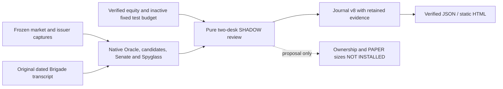
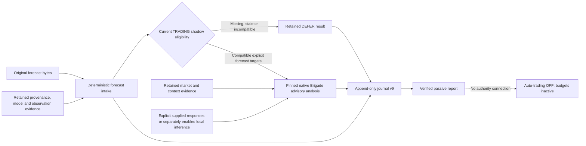

# Architecture

The current research consolidation inventory and measured readiness are maintained
in [Research acceptance](RESEARCH_ACCEPTANCE.md) and its
[validation report](RESEARCH_ACCEPTANCE_VALIDATION.md). The acceptance journal,
desk methods and later v24 qualification already exist. Consolidation adds
read-only eligibility/outcome and coverage-baseline views, plus bounded Oracle
semantic guardrails; it does not add another decision authority or journal.
All desk/capital permissions remain separate and auto-trading remains OFF.

BlackPod Battlestar's Captain's Cabin is a live, read-only presentation of
canonical mission evidence. The repository retains its existing filesystem-backed
mission orchestration and bounded ModelDock narrative seam, but the product's
normal startup is a separate artifact reader, not an orchestration command.
The [product specification](PRODUCT_SPEC.md) governs current scope;
Build Week/demo packaging is historical review infrastructure.

## Passive Decision Journal

The explicit offline `harbormaster journal` commands verify an existing mission,
project immutable revision events, retain source evidence under a separate
journal root, and append supplied evaluations. They do not participate in stage
orchestration or the Cabin reader. Existing mission schemas and decisions remain
unchanged. Historical imports default to `UNCLASSIFIED`; explicit `TRADING`,
`INVESTMENT`, or `CAPITAL_ALLOCATION` classification requires an import reason.

BlackPod's two desks have independent authority. Capital allocation is separate
oversight subject to consolidated account risk. Burst 1 can record only a
`PROPOSED` initial 50/50 allocation: activation, transfers, and automated
reallocation are disabled, and the proposal is not a perpetual rebalance rule.
Navigator SHADOW authorization remains SHADOW-only. See the
[Decision Journal design, recovery guarantees and examples](DECISION_JOURNAL.md).

The additive shadow-research layer records explicit `INVESTMENT` hypotheses with
source-event IDs, exact JSON value/timestamp pointers, dated expectations,
alternative explanations, invalidation conditions, and fixed evaluation plans.
It uses journal event v2 while retaining v1 mission/evaluation/policy bytes. Source
mission classification and approval remain unchanged. The offline
`validate-hypothesis`, `record-hypothesis`, and `show-hypothesis` commands never
invoke Oracle, ModelDock, trading workflows or capital activation. Draft authors
supply the reasoning; structure/source validation does not establish economic
truth, independent corroboration, or authenticated precommitment. See
[Investment Hypotheses](INVESTMENT_HYPOTHESES.md).

Journal event v3 adds separate challenge and outcome records linked to exact v2
hypotheses. The reviewer is declared separately from the author; source overlap
is visible and distinct artifacts are never treated as verified independence.
Outcome reports compare exact retained points with the original metric/unit/
deadline predicates. They preserve the plan, dissent and authority boundaries;
missing or premature evidence remains inconclusive or pending. No result grants
allocation, execution, capital or policy-change authority. See
[Investment Review](INVESTMENT_REVIEW.md).

## Repository boundaries

| Boundary | Responsibility | Write policy |
| --- | --- | --- |
| This repository | existing contracts/workflows plus read-only publication and Cabin presentation | implementation writable; reader never writes mission state |
| Battlestar sibling | Oracle, Council evidence chain, Governor, operator, Navigator native interfaces | read-only |
| ModelDock sibling/service | local MLX `text.generate` appliance | repository read-only; only separately authorized orchestration calls the service, never the reader |
| Mission root | canonical requests, snapshots, captured component artifacts, presentation projections | producer-owned; read-only to the Cabin reader |

No stage reads arbitrary sibling presentation output or an unqualified
"latest" artifact. Inputs are selected explicitly, copied beneath the mission
root when required, hashed, and correlated to the mission and request.

## Live presentation flow

```text
explicit artifact root + one LIVE mission ID
                    |
                    v
canonical snapshots + captured evidence (read-only)
                    |
                    v
loopback reader: validate and publish immutable bytes in memory
                    |
          /live/current.json (polled every five seconds)
                    |
                    v
browser integrity checks -> existing presentation models
                    |
                    v
Captain's Cabin -> SVG Mission Chart -> expanded Navigator V3
```

The reader accepts all legitimate mission outcomes. It does not require the
legacy approved-demo packager, select a new mission automatically, or call the
producer. The additive publication manifest is a transport wrapper; canonical
mission schemas and domain decisions remain unchanged. Source failures are
availability failures, not fabricated mission outcomes. Last verified evidence
may remain visible with explicit degraded/offline labeling and its original
timestamps.

## Existing canonical producer flow

This flow is invoked only through separately authorized mission commands. It is
not a side effect of launching or refreshing the Cabin.

```text
Mission request
    │
    ▼
Harbormaster ──► Oracle ──► ModelDock narrative (optional, explicit)
                              │
                              ▼
                           Council ──► Governor
                                         │
                              PROCEED only│
                                         ▼
                              explicit operator gate
                                         │ APPROVE_HANDOFF only
                                         ▼
                         Navigator handoff → intake → SHADOW plan
```

The unified command calls the same workflow functions used by the stage-level
commands. It does not collapse transitions, fabricate stage completion, or
rerun completed stages during resume.

## Layers

### Contracts

`src/blackpod_build_week/contracts/` defines strict versioned mission,
snapshot, ModelDock narrative, and presentation contracts. Unknown or
unsupported contract values fail closed. The canonical mission snapshot keeps
all five component stages present and separates technical status from each
component's native state.

### Adapters

The Build Week-owned adapters are narrow process boundaries around current
Battlestar Python entry points. They preserve native results, correlations,
warnings, and provenance. They do not reproduce calculations or policy.

### Stage workflows

Each workflow owns precondition checks, one stage attempt, immutable artifact
capture, and its RUNNING plus terminal snapshot transitions:

- `oracle_workflow.py`
- `oracle_enrichment_workflow.py`
- `council_workflow.py`
- `governor_workflow.py`
- `operator_workflow.py`
- `navigator_workflow.py`

### Unified orchestration

`unified_mission_workflow.py` is state-driven coordination over those existing
workflows. `mission-run` starts a mission; `mission-resume` validates stored
state and continues from the first eligible incomplete operation. Completed
identical work is an explicit no-op.

The historical demo command layer selects committed scenario inputs and
delegates to this same orchestration path. Demo-pack validation remains a
regression/review tool, not a second mission engine or live display gate.

### Persistence

`MissionStore` owns the deterministic layout:

```text
<artifacts-root>/missions/<mission-id>/
├── request/mission_request.json
├── snapshots/mission_snapshot-rNNNN.json
├── mission_snapshot.json
├── oracle/
├── council/
├── governor/
├── operator/
├── navigator/
└── presentation/
    ├── captains_log.json
    ├── captains_log.md
    ├── mission_summary.json
    ├── mission_brief.html
    └── demo_manifest.json
```

Revision snapshots and stage artifacts are immutable. The producer replaces
the current snapshot and presentation projections atomically. Every revision
carries the SHA-256 of its predecessor, producing a complete tamper-evident
chain. Containment checks reject paths outside the mission root. The reader
does not create this layout, update projections on disk, or write a demo
manifest into the selected source.

### Presentation

`mission_presentation.py` derives `captains_log.json`, `captains_log.md`, the
versioned UI-facing `mission_summary.json`, and a script-free
`mission_brief.html` from validated snapshots and recorded artifacts. The HTML
consumes the validated JSON projections and remains explicitly non-canonical.
The historical demo layer adds `demo_manifest.json`, which hashes the JSON
views and final canonical snapshot. Live publication instead derives verified
projections and a generic `presentation/manifest.json` in memory, independently
of approved-demo packaging. Neither manifest grants mission authority.

`cabin_reader.py` serves `blackpod.cabin_feed.v1` at `/live/current.json`, with
`READY`, `NOT_CONFIGURED`, or `UNAVAILABLE` status. Verified bytes are addressed
under `/live/revisions/<publication-id>/`; only the last three publications are
retained, in memory. The reader binds `127.0.0.1`, supports read methods only,
and serves the built UI without demo assets. A Vite development proxy uses the
same local `/live` interface.

The browser validates the generic manifest, correlated presentation contracts,
immutable snapshot, and referenced evidence before displaying a revision. It
does not mix one revision's projections with another revision's source bytes.
Reader `checked_at` and original snapshot `observed_at` remain distinct;
optional market/portfolio captures and ModelDock inference provenance keep
their own recorded times. Polling does not imply live market acquisition or
present ModelDock service health.

The Cabin's normal route is LIVE. Explicit `?mode=replay` is retained for
developer/historical review, with the old `?mode=demo` as a compatibility alias.
There is no normal Demo/Live switch or automatic fallback.

## State and outcome authority

Technical stage statuses are `NOT_STARTED`, `RUNNING`, `SUCCEEDED`, `FAILED`,
and `SKIPPED`. Component-native states—such as a Council posture or Governor
disposition—remain separate.

Canonical outcomes are derived from validated transitions:

- `INCOMPLETE`: orchestration deliberately stopped before a decision outcome
- `HELD`: review or explicit approval remains open
- `VETOED`: Governor `STAND_DOWN` or explicit operator rejection
- `FAILED`: a technical, schema, state, deadline, integrity, or correlation failure
- `APPROVED`: explicit operator approval followed by a validated Navigator
  SHADOW plan

Governor `PROCEED` alone is never approval.

## Transport policy

Producer LIVE and REPLAY modes are explicit and never substituted for one
another. REPLAY uses deterministic inputs while exercising the same validation,
capture, and transition logic. Producer LIVE uses native interfaces and
requires its real dependencies to succeed. Its ModelDock traffic is limited to
an explicitly configured loopback endpoint and rejects mocked responses.

The read-only live reader requires a canonical LIVE source but makes no provider
calls. Failure to read that source never starts a mission, invokes ModelDock,
selects a replay fixture, or relabels historical evidence as freshly acquired.

## Further reading

The separate [investment governance](INVESTMENT_GOVERNANCE.md) interfaces record
shadow proposals and declared human review, with immutable policy/context and
evidence hashes. These add no authority to canonical missions or Navigator
SHADOW plans. The separately invoked [auto-trading controller](AUTO_TRADING.md)
can supervise a guarded Galactica/Alpaca executor after explicit account/mode,
ownership, budget and profile confirmation. It defaults OFF and is not called
by the Cabin, journal CLI, stages or ModelDock. Execution receipts remain in
separate runtime storage and are imported through an explicit reconciliation interface.

The [paper reconciliation layer](TRADING_RECONCILIATION.md) now explicitly
imports those receipts and broker observations into journal v6. It keeps
declared desk ownership separate from authority, mirrors paper attempts into a
persistent account ledger across runtime folders, and blocks unresolved
submissions without automatic retry. The normal execution path is PAPER-only;
funded activation requires a separate governed implementation.

The [fill-lot accounting layer](TRADING_ACCOUNTING.md) adds journal v7
observations from retained individual activities, a verified flat baseline,
declared ownership and exact execution receipts. It replays long-only FIFO and
fee allocations offline. Later observations append linked results; missing
fees, uncertain attribution and position gaps remain explicit. It has no
runtime activation or broker interface.

- [Product specification](PRODUCT_SPEC.md)
- [Live product runbook](LIVE_PRODUCT_RUNBOOK.md)
- [Archived Demo Runbook](DEMO_RUNBOOK.md)
- [Safety Boundary](SAFETY_BOUNDARY.md)
- [Build Week Changelog](BUILD_WEEK_CHANGELOG.md)

## Shadow two-desk review

The additive [two-desk review](SHADOW_DESK_REVIEW.md) consumes frozen market,
issuer and inactive budget evidence through explicit deterministic interfaces.
`shadow_native_analysis.py` replays the reviewed pure native Oracle → candidate
→ Senate definitions from retained, fixed-fingerprint source files.
`shadow_galactica_analysis.py` connects native Spyglass structures and optionally
parses original historical Brigade opinions. It does not produce current
Brigade forecasts or call the legacy inference/orchestration path.



The spanning review uses `CAPITAL_ALLOCATION` research semantics and has no
capital, execution, authorization or policy-change authority. Native evidence
sharing is explicit; multiple artifacts are not counted as independent
analysts. TRADING and INVESTMENT research have disjoint proposed ownership and
different horizons, with the fixed 25%-of-captured-equity budget split equally.
No continuing 50/50 rebalance is implied. Canonical mission schemas, stages,
Navigator SHADOW behavior, ModelDock settings and the separate OFF execution
controller are unchanged. The design's module inventory records which
interfaces are actually connected to this review and which remain optional,
historical, operational or research-only.

## Governed forecast and Brigade evidence seam

The additive [governed forecast intake](FORECAST_BRIGADE_SHADOW.md) admits
source-bound daily USD closing-price forecasts into a separate passive
research lifecycle. The immutable source row, original source precision,
explicit horizon, issue/data cutoffs and retained model/producer evidence
remain distinguishable. Source/model review is declared, not authenticated
or a claim that the statistical model was retrained or calibrated.



The Brigade seam preserves individual Scout, Sentry, Advisor, Canary and
Pathfinder contributions, their response provenance and dissent. Its native
trade-plan builder is suppressed before quantities, stops, sizing or order
guidance are constructed. Shared forecasts are one evidence ancestry, not
independent model votes. Different-horizon predictions at one as-of date form
an explicitly labeled future forecast path for Pathfinder; observed OHLCV
supplies historical trend, volume and regime context. Forecast targets never
become realized prices. Native Decay's exported interface does not match the
optional Watchtower import; the new adapter invokes `Blackwell_Decay`
separately on observed closes and labels that separate calculation explicitly.

Journal v9 appends `FORECAST_INTAKE_RECORDED` and
`BRIGADE_SHADOW_ANALYSIS_RECORDED`; the latter links the original TRADING
intake decision. Verified reads replay retained source and opinion bindings;
they do not call ModelDock, load model artifacts or rerun training. These
records do not replace prior v8 two-desk reviews, authorize execution, install
ownership, activate capital or alter canonical mission state. A short-horizon
INVESTMENT intake is retained with an explicit deferral.

## Governed current forecast producer

The [governed forecast export](GOVERNED_FORECAST_EXPORT.md) adds an explicit
producer upstream of the existing intake. Reviewed Galactica feature and
quantile definitions run in an uncached fitting path using an already-installed
runtime. The sibling producer's import-time directory creation, cached joblib
loading and model-cache writes remain excluded. Numeric model evidence is
retained as data, and verified journal reads never train or execute it.

Retained session closes establish completed observations and future target
sessions. Training rows bind both their feature observation and later target
availability. Exported quantiles preserve their original level identities;
crossing cannot be silently repaired by sorting. Raw source evidence, native
features, forecasts, intake dispositions, Brigade recommendations and local
response receipts remain linked but distinct stages. Currentness is checked
again before optional advisory inference.

This interface does not reconnect legacy execution or alter canonical mission
stages. It creates no investment thesis, desk ownership, capital authorization
or order. The separate execution controller remains OFF, and current forecast
or Brigade agreement cannot activate it.

## Versioned structured Brigade response seam

The [structured Brigade interface](BRIGADE_STRUCTURED_RESPONSES.md) adds v2
requests, transcript bundles and analysis, with exact six-field advisory member
responses. A per-member schema binds the native persona and symbol; strict
local validation precedes a deterministic three-label projection into the
original source-pinned parser. Raw JSON, validated fields, projected labels and
native parser output remain distinct evidence. Native prompts and analytical
context are unchanged, and the trade-plan builder remains suppressed.

Journal v11 records structured reviews against the original verified intake
decision. V1 responses and v9 reviews continue to use their old versioned replay
paths; no historical malformed text is reinterpreted by the new contract.
Provider-free replay verifies responses, projections, dispositions and source
bindings. Explicit generation keeps durable attempts, bounded local calls and
receipt-only recovery without automatic retries.

This seam changes an analytical output interface, not decision authority.
Typed BUY or EXIT remains advisory, heuristic confidence remains uncalibrated,
and shared model ancestry remains visible. It does not alter missions, ModelDock
configuration, budgets, ownership or the separate OFF execution controller.

## Trading strategy rebuild roadmap — October 12, 2026

**Product direction: rebuild the TRADING strategy rather than reuse Galactica's
existing trading logic.** This direction applies to short-horizon day/swing
trading, not the independently governed INVESTMENT desk. The prior bursts
established safer interfaces, evidence retention and operational controls;
they did not establish a superior or profitable trading strategy. This roadmap
records intended work, not an implemented replacement or permission to trade.
Auto-trading remains OFF and the recorded desk budgets remain inactive.

### Current reuse and the replacement boundary

The optional paper executor still defaults through
`auto_trading_worker.py::run_worker` to
`galactica_trading_adapter.py::run_guarded_navigator`. That adapter imports
the pinned Galactica `blackwell_navigator_trickle`, instantiates its native
`NavigatorTrickle`, delegates to its original `on_bar`, and retains its mandate
gate. The broker facade adds ownership, account, budget, order, switch and
interrupted-processing controls around the native strategy. It does not
replace native EMA/bias entry logic, exits, trailing-stop decisions or sizing.
This path is present in code but the current worker is inactive and OFF.

Research also retains legacy interpretations:
`shadow_brigade_analysis.py` uses the original five Brigade prompts and
parsers plus native Decay; `shadow_galactica_analysis.py` uses native Spyglass;
`shadow_quantitative_producer.py` uses Galactica feature and linear-quantile
definitions. The separate `shadow_native_analysis.py` reuses Battlestar
candidate and Senate calculations. They are source-bound research/replay
interfaces, not evidence that these rules deserve production authority.

The new production strategy must not inherit Galactica's entry/exit rules,
mandates, signal thresholds, stop policies, position-sizing heuristics,
Brigade voting criteria or forecast-model presets. Existing Battlestar
candidate rankings likewise receive no automatic grandfathering. Historical
records and versioned replay remain intact; legacy strategies may be evaluated
as explicitly labeled comparison baselines, never silently substituted for
the replacement. The next trading development work should establish this new
research/evaluation boundary before further polishing legacy decision rules.
The shadow desk review's existing pilot ranking/sizing proposals also remain
comparison artifacts; their explicitly unestimated expected returns cannot
justify adopting them as the new strategy's sizing policy.

Reuse is appropriate for independently verified infrastructure: retained
market-data interfaces, source/time/version identities, append-only journal,
fill-lot and fee accounting, reconciliation, desk isolation, budget checks,
single-worker admission, order idempotency, broker transport and operational
kill controls. Extract and revalidate these behind strategy-neutral interfaces;
their current coupling to a native executor is not an approved replacement
seam. Preserve protective handling of any existing positions during eventual
retirement, rather than assuming the account is flat.

Standard mathematical measures may be independently implemented or retained
as observations. Their availability does not grandfather an associated trading
interpretation, threshold, fitted model or policy. No selected legacy research
artifact automatically becomes an authorized production input.

### Target authority and evaluation

The target sequence is observed market evidence, independently validated
features/forecasts, a versioned strategy proposal, deterministic risk checks,
explicit authorization, executable intent, broker execution, reconciliation,
and linked outcome evaluation. Forecasts, recommendations, authorizations and
orders stay distinct. LLMs may assist research, challenge and explanation;
persona agreement or narrative confidence alone must not trigger orders.
Trading evaluation uses trading outcomes, not investment-thesis evaluation or
cross-desk capital reallocation.

"Best in class" is an evaluation objective, not a claim established by adding
more indicators, larger models or sophisticated metrics. Predeclare relevant
benchmarks, sampling conventions, costs and acceptance criteria. Compare a
small number of explicit new hypotheses, and retain every trial and failure.
Advanced methods must demonstrate incremental value against simple, newly
specified baselines under the same conditions before adoption.

The evaluation specification should cover:

- Economic performance: net return and expectancy after spreads, slippage,
  fees and relevant financing costs; risk/exposure-matched baselines, turnover,
  holding periods and capacity assumptions. Win rate alone is insufficient.
- Risk: drawdown depth and duration, downside and tail losses, concentration,
  correlation and exposure; consistently defined Sharpe/Sortino and recovery
  measures where assumptions and sample support them.
- Statistical credibility: chronological out-of-sample and walk-forward
  evaluation, label-availability checks, overlap-aware purging/gaps, selection
  bias diagnostics, uncertainty and stability across regimes. Record trial
  counts; never tune on the final holdout or treat one high Sharpe as proof.
- Forecast quality, where used: proper forecast losses, directional/value
  baselines, interval coverage and calibration over declared horizons. These
  remain separate from net strategy performance.
- Execution and operations: fill/partial-fill behavior, measured slippage,
  order latency/rejections, stale-feed handling, deterministic risk rejection,
  restart recovery and bounded exposure under failures. Paper fills are not
  evidence of live executable capacity.

Chronological splits must respect actual observation and target availability;
a generic time-series splitter alone does not establish leakage-free financial
validation. The [scikit-learn time-series validation reference](https://scikit-learn.org/stable/modules/generated/sklearn.model_selection.TimeSeriesSplit.html)
documents ordered splits and a configurable gap. Selection bias and non-normal
returns motivate considering the [Deflated Sharpe Ratio](https://www.davidhbailey.com/dhbpapers/deflated-sharpe.pdf);
the [Probability of Backtest Overfitting](https://www.davidhbailey.com/dhbpapers/backtest-prob.pdf)
provides another research framework. Neither statistic guarantees future
returns or replaces independent chronological testing and economic assumptions.
Specific formulas, applicability and promotion thresholds remain design work;
this roadmap installs none of them.

### Incremental work and measurable gates

| Step | Required work | Completion gate |
| --- | --- | --- |
| 1. Specify the new trading research contract | Define trading universe, day versus swing horizons, decision times, evidence availability, expected edge, costs, benchmark, allowed exposure and failure criteria; inventory legacy retirement seams. | Reviewed versioned specification; explicit non-inheritance list; no legacy strategy selected as the new engine; auto-trading OFF. |
| 2. Build the offline evaluation foundation | Strategy-neutral deterministic simulation, timestamped observations/labels, costs, trade/account ledger, experiment identities and trial registry. | Synthetic/adversarial tests catch leakage, impossible fills, accounting errors and duplicate events; exact replay; no broker/provider dependencies in offline execution. |
| 3. Research new strategies | Implement a few independently specified hypotheses and simple baselines; add advanced forecasting only when it earns incremental value. | Predeclared evaluation passes on chronological held-out data, after costs, with uncertainty/selection-bias and regime diagnostics; failed alternatives retained; no claimed edge from format validity alone. |
| 4. Run the replacement in shadow | Emit new structured proposals, independent risk dispositions and linked outcomes alongside retained observations. | No execution effects; deterministic proposal-to-outcome audit; falsifiable expectations; source/currentness/consistency failures defer; no autonomous policy changes. |
| 5. Establish a replacement execution seam | Decouple strategy decisions from the Galactica Navigator and reuse only independently validated transport/safety infrastructure. | New candidate execution path invokes no legacy strategy/prompt/mandate defaults; ownership/budget/order/risk/restart/kill-control tests pass; migration accounts for existing positions. |
| 6. Authorize bounded paper testing | Separately approve the replacement strategy version, ownership, inactive desk budget activation, size limits, loss limits and rollback/stop conditions. | Explicit human authorization; bounded mechanical and strategy tests; verified fill/fee reconciliation; continued comparison to predeclared research expectations. |
| 7. Consider wider authority | Evaluate repeatability, net outcomes, operational reliability and failure recovery before any broader autonomy. | Separate reviewed activation decision with demonstrable risk controls and rollback; no automatic promotion or capital transfer from recent wins. |

**Recommended next trading burst: new Trading Research Contract and Offline
Evaluation Foundation.** Begin with the strategy-independent specification,
leakage/cost/accounting tests and reproducible experiment records. Do not
activate the current legacy worker as a shortcut to testing trading edge.
The previously recommended Brigade evidence-consistency review remains useful
for diagnostic research, but improving legacy votes is not a prerequisite for
or substitute for rebuilding the trading strategy. No replacement strategy or
evaluation harness is implemented by this documentation update.

### Trading research foundation implemented — October 12, 2026

The approved next burst now implements the new, independent
[Trading Research Contract and Offline Evaluation Foundation](TRADING_RESEARCH.md).
This is a separate research boundary rather than an extension of Galactica's
strategy rules. `contracts/trading_research.py` provides strict immutable v1
plan, dataset and externally authored decision contracts; no executable
strategy plugin, legacy forecast preset or native voting/sizing rule is selected.

`trading_research_evaluation.py` independently implements a deterministic,
development-only daily next-open simulator for SWING research. It projects
chronological train/validation/test and label-availability purges, withholds
final-holdout scoring, enforces declared cost/cash/exposure/known-volume bounds,
and preserves simulated fills, FIFO matches, rejected decisions and marked
outcomes. DAY hypotheses remain declarable but defer until suitable intraday
data and fill conventions exist. Descriptive measures and CASH comparison
are an evaluation foundation, not a demonstrated trading edge or a claim of
state-of-the-art performance.

`trading_research_journal.py` and `trading_research_cli.py` add passive journal
v12 trial registration and linked, reproducible simulation evaluations.
Every locally preceding trial in an experiment must remain declared; the
registered comparison protocol/data/cost/risk boundary is fixed. The original
plan and evidence remain immutable. Registry completeness, author ancestry,
source authenticity and prospective preregistration remain explicit limits.
The wholly synthetic `trading_research_example.py` demonstrates accounting
and rejection behavior without a provider, broker or production strategy.

This implements the foundation in roadmap steps 1–2, not a validated replacement
strategy or execution migration. The next trading burst is to independently
specify a small number of new hypotheses and simple baselines, register all
trials, and assemble versioned historical evidence with suitable availability,
cost and benchmark controls for chronological evaluation. Auto-trading remains
**OFF**, recorded desk budgets remain inactive, and investment authority is
unchanged.

The earlier Brigade evidence-consistency recommendation remains a separate
optional diagnostic branch. It can flag contradictions in retained advisory
research while preserving original recommendations and dissent. It neither
blocks the independent trading rebuild nor substitutes for testing economic
performance, and it is not implemented in this burst.

## Governed historical trading research — Burst 12

`contracts/trading_hypothesis.py` and `trading_hypotheses.py` freeze independent
previous-session reversal and five-session continuation proposals. Their
lookbacks and holding intervals are untuned specifications, with mechanisms,
alternatives, explicit falsification, cost stress and required controls. No
strategy producer or optimal symbol/size selection exists yet.

`contracts/historical_intake.py` and `trading_historical_intake.py` verify retained
GET receipts, daily raw bars, complete eligible returned calendar coverage and
explicit retrospective availability. Dataset v2 preserves capture provenance
separately from modeled historical availability. The pure evaluator supports
plan v2 only in `DATA_QUALITY_ONLY` mode with empty intents, no metrics and no
final-holdout scoring; the original v1 behavior remains independently versioned.

`trading_research_intake_journal.py` adds passive v13 catalog/intake events.
Existing research journal v14 requires a preceding exact frozen hypothesis and
source-rebuilt dataset. Evaluations append linked records and replay from
retained bytes. `trading_research_intake_cli.py` supplies explicit offline
freeze/export/verify/record/prepare commands; no live orchestration is wired.
See [design and usage](TRADING_HISTORICAL_RESEARCH.md) and
[validation](TRADING_HISTORICAL_RESEARCH_VALIDATION.md).

## Deterministic governed shadow studies — Burst 13

`contracts/trading_shadow_research.py` defines new studies, continuity and cost
reviews, and independently retained review-source declarations. A study binds
an original registered v2 quality plan and its hypothesis/dataset without
rewriting those sources. `trading_shadow_gates.py` verifies exact bytes,
universe, complete coverage, review chronology, corporate-action events and
all cost-stress bounds. Local review statements remain unauthenticated; fixture
evidence cannot clear the retained-history research scope.

`trading_shadow_intents.py` implements the independently specified sign rules
using available completed closes. Its whole-share sizes derive from an explicit
simulated notional and known close; all opportunities and deferred exits remain
visible. `trading_shadow_evaluation.py` reuses existing generic simulation
arithmetic through an ephemeral adapter. It adds equal-weight fractional
counterfactual cohorts matched to accepted entry purchase notional and duration,
with their own shared cash, exposure and known-volume constraints. It does not
match daily exposure/beta. Noncomparable controls or observed risk breaches
yield inconclusive comparisons, without a selected winner.

`trading_shadow_journal.py` adds v15 immutable registrations and linked
evaluations, retaining source evidence and calculation-version hashes. Changes
to pinned calculations require compatible replay/version handling before old
history can be used with a changed installation. `trading_shadow_cli.py` exposes
explicit offline prepare/register/evaluate/record/show/render/verify commands.
No live orchestrator or execution controller consumes these research intents.
See [design and usage](TRADING_SHADOW_RESEARCH.md) and
[actual validation](TRADING_SHADOW_RESEARCH_VALIDATION.md).

## Governed evidence adapters and simulation risk review — Burst 14

`trading_continuity_intake.py` projects retained native corporate-action pages
and receipts into independently reviewable coverage and discontinuity evidence.
Process-date queries cannot establish effective-date coverage alone.
`trading_cost_intake.py` preserves native quote updates at nanosecond precision,
computes upward-rounded observed spread bounds and requires separately retained
slippage/fee assumptions. Partial samples and unsupported sources stay deferred.

`trading_shadow_risk_review.py` assesses explicit simulation cash/order/exposure
caps and TEST opportunity quantities from known completed closes and volume.
The review is a local claim, with no desk activation or execution authority.
`trading_shadow_review.py` adds a v2 declaration and an ephemeral, risk-only
projection around the unchanged v1 producer/evaluator. Original source plans
remain registered and unchanged; proposed risk does not clear eligibility.

`trading_shadow_review_journal.py` adds v16 adapter, risk-review, registration
and linked evaluation events. Unique preceding source records, exact hashes,
review chronology and sixteen calculation-source snapshots support replay.
`trading_shadow_review_cli.py` supplies twelve explicit offline commands and
escaped reports; native capture is a separate read-only operator action.
See [design and commands](TRADING_SHADOW_EVIDENCE.md) and
[actual validation](TRADING_SHADOW_EVIDENCE_VALIDATION.md).
