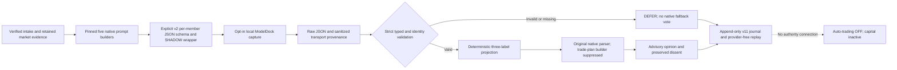

# Versioned structured Brigade shadow responses

The Brigade v2 request boundary asks for typed advisory fields instead of a
JSON string containing free-form labeled text. It addresses responses that
previously satisfied `{"brigade_text": "..."}` while omitting the native
`ACTION`, `CONFIDENCE` or `REASONING` labels. Validation remains strict, all
authority remains disabled, and auto-trading remains **OFF**.

This interface does not change canonical missions, trading policy, native
Brigade source, ModelDock routing or model configuration. It creates no desk
ownership, activated budget, executable order or realized trade P&L. The fixed
testing budgets remain inactive. It adds neither agents nor dependencies.

## Contracts and compatibility

| Retained document | Existing path | Structured path |
| --- | --- | --- |
| Brigade request | `blackpod.brigade_shadow_request.v1` | `blackpod.brigade_shadow_request.v2` plus explicit `response_contract` |
| Member output | Native labels in `brigade_text` | `blackpod.brigade_member_response.v1` direct JSON |
| Analysis | `blackpod.shadow_brigade_analysis.v1` | `blackpod.shadow_brigade_analysis.v2` |
| Transcript bundle and generation attempt | v1 | v2 |
| Brigade journal event | `blackpod.decision_journal_event.v9` | `blackpod.decision_journal_event.v11` |

Old requests, raw responses, wire payloads and journal events replay through
their original versions. A new version cannot reinterpret malformed historical
text as a valid opinion. Version mixing rejects. Reusing an analysis identity
with different evidence or a different contract conflicts rather than rewriting
the original event. Existing producer v10 and intake v9 events are unchanged.

The v2 request declares:

```json
{
  "schema_version": "blackpod.brigade_shadow_request.v2",
  "response_contract": "blackpod.brigade_member_response.v1"
}
```

Those two fields extend the complete original request; the abbreviated snippet
is not a valid standalone request. Mode remains `SHADOW`, domain `TRADING`, and
scope `BRIGADE_RECOMMENDATIONS_ONLY`. The containing request owns those values
and the four false authority flags. A model cannot grant itself authority by
adding fields to its response.

## Strict member output

`contracts/brigade_response.py` accepts exactly six fields:

```json
{
  "schema_version": "blackpod.brigade_member_response.v1",
  "member": "Blackwell_Scout",
  "symbol": "SYNTHETIC",
  "action": "BUY",
  "heuristic_confidence": 0.6,
  "reasoning": "Synthetic structured example view for offline replay; no actual market prediction."
}
```

The action must be `BUY`, `EXIT`, `HOLD` or `WATCH`. Member and symbol must match
the external native request. Confidence must be a finite JSON number between
zero and one; strings and booleans reject. It is a heuristic label, never a
calibrated probability of profit. Reasoning must be nonblank, bounded to 4,096
characters and 16 KiB, and remain a single line without control characters or
leading/trailing whitespace. Raw JSON is limited to 32 KiB.

Missing or extra fields, duplicate keys, wrong identity/version, nonfinite
numbers, fenced JSON, prose outside the JSON object, execution/order fields and
probability claims reject. No extraction, coercion, fence removal, default
labels, content repair or fallback to `brigade_text` is performed. A syntactically
valid payload can still fail the local semantic validator.

For an accepted response, `native_label_projection` deterministically emits
exactly three native labels. Its action, confidence and full reasoning must
round-trip through the original source-pinned parser. The raw structured JSON,
validated mapping, projected native labels and native parser output remain
different retained facts. Single-line reasoning cannot inject a second native
action or confidence label.



## ModelDock and replay boundary

The explicit local capture reuses `ModelDockClient.generate_text`. A per-member
`json_schema` binds the schema version, native member and symbol; it constrains
the action enum, numeric confidence bounds, reasoning length and exact field
set. BlackPod independently validates the returned content and retained source
bindings. ModelDock's schema acknowledgement alone does not validate economic
reasoning or approve a trade.

The original native system and user prompt bodies remain retained. A versioned
wrapper makes the typed output format explicit while preserving their analytical
criteria and requested token budget. BlackPod supplies no model or sampling
override; the appliance owns routing and generation configuration. Unsupported
structured decoding, truncation, mismatched correlation, mock output, failed
semantic validation and expired evidence cannot become a recommendation.

Durable generation and per-call intents precede each local POST. Completed
attempts reuse their exact capture without inference; interrupted attempts use
explicit `recover`, consume only retained receipts, and defer missing members.
Failed or uncertain calls do not automatically retry. Bounded safe failure
diagnostics retain hashes and sizes without publishing arbitrary provider error
bodies. Accepted raw structured responses remain retained as evidence.

Default assessment, recording, showing, rendering and verification perform no
provider call. Fresh generation requires both a current eligible request and
explicit `generate --modeldock-shadow`. It cannot start or configure ModelDock,
call the legacy Galactica provider, activate auto-trading or submit an order.
Transport `LIVE` identifies a real local text request; the analytical desk mode
remains `SHADOW`.

## Runnable wholly synthetic example

Run from the repository root. The example reuses
`forecast_brigade_example.example_material` for authored market/forecast input
and adds distinct v2 research identities. Its response strings are authored
fixtures, not model-generated market views. It contains no test imports,
credentials, network calls, model inference or sibling application dependency.
Native source fixtures supply the reviewed prompt builders, parser and separate
Decay calculation. Output is marked `SYNTHETIC_FIXTURE` with fixed source dates.

```bash
PYTHONDONTWRITEBYTECODE=1 PYTHONPATH=src .venv/bin/python3.11 \
  -m blackpod_build_week.brigade_structured_example \
  --output-root output/brigade-structured-example

PYTHONDONTWRITEBYTECODE=1 PYTHONPATH=src .venv/bin/python3.11 \
  -m blackpod_build_week.brigade_shadow_cli assess \
  --journal-root output/brigade-structured-example/journal \
  --request output/brigade-structured-example/request.disabled.json \
  --evidence-root output/brigade-structured-example/evidence

PYTHONDONTWRITEBYTECODE=1 PYTHONPATH=src .venv/bin/python3.11 \
  -m blackpod_build_week.brigade_shadow_cli record \
  --journal-root output/brigade-structured-example/journal \
  --request output/brigade-structured-example/request.disabled.json \
  --evidence-root output/brigade-structured-example/evidence

PYTHONDONTWRITEBYTECODE=1 PYTHONPATH=src .venv/bin/python3.11 \
  -m blackpod_build_week.brigade_shadow_cli record \
  --journal-root output/brigade-structured-example/journal \
  --request output/brigade-structured-example/request.replay.json \
  --evidence-root output/brigade-structured-example/evidence

PYTHONDONTWRITEBYTECODE=1 PYTHONPATH=src .venv/bin/python3.11 \
  -m blackpod_build_week.decision_journal_cli verify \
  --journal-root output/brigade-structured-example/journal
```

Preparation seeds one original forecast event. Recording the disabled request
adds a fully deferred structured review; recording the declared replay adds
five authored views with explicit BUY/EXIT/HOLD/WATCH dissent. The expected
result is three verified events with zero orphan evidence. Repeating preparation
or recording is idempotent. Existing changed output bytes are not overwritten.
The old `forecast_brigade_example` remains separate and unchanged.

Use the returned replay `event_id` to inspect or render that verified event:

```bash
PYTHONDONTWRITEBYTECODE=1 PYTHONPATH=src .venv/bin/python3.11 \
  -m blackpod_build_week.brigade_shadow_cli show \
  --journal-root output/brigade-structured-example/journal \
  --event-id YOUR_RETURNED_REPLAY_EVENT_ID

PYTHONDONTWRITEBYTECODE=1 PYTHONPATH=src .venv/bin/python3.11 \
  -m blackpod_build_week.brigade_shadow_cli render \
  --journal-root output/brigade-structured-example/journal \
  --event-id YOUR_RETURNED_REPLAY_EVENT_ID \
  --output output/brigade-structured-example-report/review.html
```

The fixed-dated example is for offline replay. It is not a current request for
fresh inference. For a separately authorized current capture, create a v2
request binding an already verified current intake and retained market evidence,
then explicitly invoke:

```bash
PYTHONDONTWRITEBYTECODE=1 PYTHONPATH=src .venv/bin/python3.11 \
  -m blackpod_build_week.brigade_shadow_cli generate --modeldock-shadow \
  --journal-root output/YOUR_CURRENT_JOURNAL \
  --request output/YOUR_CURRENT_V2_REQUEST.json \
  --evidence-root output/YOUR_CURRENT_EVIDENCE \
  --output-directory output/YOUR_NEW_CAPTURE \
  --modeldock-base-url http://127.0.0.1:8000 \
  --modeldock-timeout-seconds 30 --modeldock-delivery-grace-seconds 5
```

The placeholders are deliberately not runnable current evidence. The output's
sealed `request.replay.json` and `evidence` directory can subsequently be
recorded with the same passive `record` command. Explicit recovery uses `recover`
with the original disabled request and consumed output directory; it requires
no generation flag or provider connection.

## Validation and limits

The offline suite tests contract/type/identity boundaries, original source and
prompt preservation, deterministic projections, malformed-response deferral,
rehashed semantic tampering, v1/v2 compatibility, receipt recovery, append-only
journal behavior and portable synthetic examples. Tests block actual providers,
brokers, subprocess inference and execution. See
[the implementation validation report](BRIGADE_STRUCTURED_RESPONSES_VALIDATION.md)
for exact commands, actual results and real-history versus fixture coverage.

Typed output improves parseability. It does not establish factual truth,
independent evidence, calibrated confidence, a sound hypothesis or profitable
performance. The five personas share their forecast, market and interpretation
model ancestry; agreement is not five independent forecasts. Existing v1
observed-context policy remains unchanged, including exclusion of same-UTC-day
bars. Separate Decay continues to use retained observed history. Structured
short-horizon analysis cannot override a long-horizon investment thesis or the
independent deterministic trading-risk boundary. Every accepted opinion remains
advisory research.
