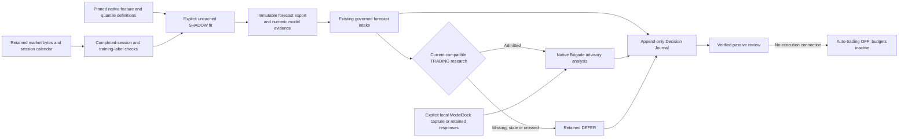

# Governed forecast-producer export

The forecast producer is a separately invoked SHADOW research interface. It
exports newly fitted daily USD closing-price forecasts with the source,
configuration, feature, training-label, model and session evidence required by
the [governed forecast intake](FORECAST_BRIGADE_SHADOW.md). The admitted
forecasts can then supply the existing five-member Brigade advisory analysis.
**Auto-trading remains OFF.** The fixed TRADING and INVESTMENT test budgets
remain inactive; the export installs no ownership, sizing or execution policy.

Forecasts, recommendations, authorizations and executable orders remain
different objects. A current forecast is permission to examine research
evidence. It is not an approved trade, an allocation instruction, a calibrated
probability or proof of positive expected returns. The one-through-five-session
forecast interface remains short-horizon TRADING research. It cannot substitute
for a longer-horizon investment thesis.

## Source landscape and preserved behavior

The actual producer inspected in the read-only Galactica checkout is
`phase2_forecast_engine.py`. Its `generate_forecast` method enriches observed
OHLCV, constructs supervised targets using `Close.shift(-h)`, fits quantile
models and predicts future closing-price levels. The observed feature date,
forecast production time and target session close are distinct timestamps.
`models/model_library.py::enrich_features` supplies the actual technical feature
definitions, including the SMA, EMA, RSI, MACD, Bollinger and ATR calculations.

Importing the legacy producer creates forecast and model-cache directories;
calling its original cache helper can load or write joblib artifacts. The
governed interface uses reviewed, fixed-fingerprint pure definitions and an
explicit uncached fit. It does not import the original orchestrator, invoke its
cache loader, deserialize model artifacts, change Galactica configuration or
write into the sibling checkout. Model parameters and fitted numeric evidence
are retained as data. Verification does not refit models.

The legacy `generate_forecast` implementation sorts three independently
predicted levels before assigning Q10/Q50/Q90. A governed export retains each
level with its original quantile identity. Crossing is visible and blocks
admission; no sorting repair converts crossed levels into a valid band.

The Build Week virtual environment has pandas and NumPy but lacks the native
fitting dependencies. The existing Galactica interpreter provides them without
installation. Missing or incompatible dependencies are an explicit producer
failure, not permission to substitute an algorithm or synthetic forecast.

The inspected existing interpreter is
`/Users/nikolai/BlackPod-Versions/blackpod_galactica/galactica/bin/python`:
Python 3.11.14, pandas 2.3.1, NumPy 2.4.2, scikit-learn 1.8.0, SciPy 1.17.0
and joblib 1.5.3. These are research-run provenance, not new Build Week
dependency requirements. The quantitative method is a separately versioned
SHADOW use of the native linear-quantile defaults; it does not establish which
model type an unrelated Galactica process selected through its environment.

## Completed observations and explicit targets

Daily bars retain their exact source timestamps and values. An exchange session
calendar establishes when a bar's session closed; its date label is not silently
treated as a midnight observation or invented closing time. Only observations
whose retained session close precedes the market capture can become completed
feature or supervised-target evidence. An incomplete same-day bar cannot become
the feature anchor merely because it is the final row returned by a data API.

For each horizon, a training feature observation is linked to the later close
that supplies its target. The availability cutoff includes that target close,
so the training record cannot claim knowledge of a label before it was
observed. Feature and training evidence retain the exact rows actually used
after the native indicator warmup and horizon filtering. A requested training
window is not a claim that the full window was available.

The newest engineered feature vector is conservatively available at the actual
retained market-capture instant. It is not backdated to the regular close,
because the input packet supplies full daily OHLCV and volume. The reference
closing price and supervised target observations retain their explicitly
recorded session-close times. Original bar labels, capture time, feature
availability, target observation time and model issuance remain separate.

Future targets come from retained ordered trading sessions. A horizon of five
sessions is not five calendar days. The explicit reference close and its
observation time remain separate from the predicted level, and nominal quantile
labels remain uncalibrated until independent evaluation establishes coverage.
The retained endpoint supplies explicit market-day opens and closes, including
early closures; this interface converts those times using the named
`America/New_York` zone. See the [Alpaca US market calendar
reference](https://docs.alpaca.markets/us/reference/legacycalendar).

IEX evidence is single-exchange market data. Its volume cannot be described as
consolidated volume, and distinct Brigade personas sharing one fitted forecast
ancestry do not create independent statistical confirmation.
The source feed and raw adjustment are retained explicitly, and a non-null
pagination token prevents claiming a complete capture. See the [Alpaca
historical stock bars reference](https://docs.alpaca.markets/us/reference/stockbars).

## Versioned interfaces and retained evidence

`contracts/forecast_producer.py::ForecastProducerRequest` validates
`blackpod.forecast_producer_request.v1`. Its domain is TRADING, its mode is
SHADOW and its scope is `SHADOW_FORECAST_PRODUCTION_ONLY`. The request binds
one through eight explicit sorted symbols, requested one-through-five-session
export horizons,
the retained market packet, raw calendar response, calendar GET receipt and
the exact native source closure. Every authority flag must be false.

The fixed reviewed source fingerprints are:

| Retained native file | SHA-256 |
| --- | --- |
| `phase2_forecast_engine.py` | `cc1a15539b72507cd8d0c0aca09f7a10132c49b2c8476e5a849976ae71551205` |
| `models/model_library.py` | `c865de17d1e4bd0efe8161ec9be81cb47ec892358144c23c5e93ab7cd5b5d76b` |

`shadow_quantitative_producer.py` selects the reviewed native feature,
feature-selection and model-construction definitions. The worker fits the
native default five horizons with three distinct quantile models per horizon;
requested export horizons select which outputs enter intake. It preserves the
actual configuration, including the original persistence declarations, while
excluding the persistence functions from its executable definition closure.
No ambient `PHASE2_MODEL_TYPE` overrides this separately versioned method.

`forecast_producer_export.py::build_forecast_producer_export` produces
`blackpod.forecast_producer_export.v1`, with actual generation start, completion
and post-fit issuance clocks. It retains completed features, per-horizon
supervised training rows, coefficients and intercepts, original labeled
quantiles and a separately labeled native sorted preview. Each symbol has one
model-family origin containing up to fifteen distinct horizon/quantile models.
All five available horizons require fifteen models. The
family identity allows the existing Brigade to consume one future target path
without falsely treating the fifteen models as independent votes.

Feature and training observation evidence v2 preserves the native numeric
spellings within bounded precision. Training evidence v3 groups distinct
actual datasets by horizon; an h1 training proof cannot stand in for h2–h5.
Existing v1 observation contracts and prior journal records retain their
original semantics. Calibration evidence remains null.

`validate_forecast_producer_export_bundle` reconstructs features and training
labels from retained bars and sessions, checks numeric coefficient predictions,
and rebuilds the exact export/intake evidence closure. It never refits a model,
loads an estimator or calls a provider. This verifies source and arithmetic
bindings, not whether the coefficients solve the original fitting objective,
the vendor returned every session, or the model has predictive skill. Runtime
versions and machine review identities are retained declarations.

The passive journal adds v10 `FORECAST_PRODUCER_EXPORT_RECORDED`, followed by
the existing v9 `FORECAST_INTAKE_RECORDED`. Exact original intake and source
hashes bind the stages; v9 is not rewritten to require a new producer
predecessor. The Brigade record links the verified intake event. The producer
and intake append are separate commits: after an interruption between them,
the same record command reuses the committed producer and appends the missing
intake. Immutable evidence stays separate from native source storage.

An explicit CPU production attempt reserves its input/runtime identity before
fitting. A completed retry reuses its result and fits zero new models. A consumed
attempt with missing result or receipt refuses an automatic refit. An explicit
export may seal already-retained worker result and receipt bytes; it performs
no fitting. A new research run requires a distinct declared run identity and
output destination.

## Passive research flow



## ModelDock discovery and capture

The inspected ModelDock appliance documents its loopback origin as
`http://127.0.0.1:8000`. The October 12, 2026 integration acceptance record
reports a rebuilt service with Qwen3-1.7B-4bit selected. The read-only user
configuration and runtime state also identify that selection and READY state.
Those retained observations do not prove present availability or idle compute.

Before an explicitly enabled Brigade capture, use the appliance's lightweight
health and stats interfaces to check actual service state, `active_requests`
and `active_compute`. A ready health response alone does not prove idle state.
These GETs do not run inference. Build Week's deep ModelDock preflight does run
inference and is not a substitute for status-only discovery.

The existing strict `ModelDockClient` owns local text transport validation, and
the existing Brigade capture/recovery interface owns durable call intents and
receipts. The appliance retains model selection and sampling authority. No
model activation, registry alteration, service startup or configuration change
belongs to forecast export. The capture's transport mode LIVE denotes a real
local text call; the analytical domain remains SHADOW and has no trading
authority.

The Brigade capture remains bounded to 40 member requests and 300 seconds per
attempt. A process-local service timeout and delivery grace must fit that
attempt budget before any request starts. A failed or uncertain delivery stops
further calls. Recovery consumes retained receipts, defers missing members and
makes no automatic inference retry.

## October 12 current-source run

The separately authorized real-source capture retained successful read-only
Alpaca market and calendar responses at approximately 3:36 PM Pacific. The
explicit CPU worker fitted thirty native linear-quantile models for SPY and
QQQ and issued the result at `2026-10-12T22:40:44Z` (3:40:44 PM Pacific).
All ten raw labeled forecast rows were ordered and admitted at that frozen
intake clock. This is a current-source integration result, not a performance
evaluation or claim that their quantile bands are calibrated.

Each symbol supplied 760 daily bars. The native 252-row feature window
produced 251, 250, 249, 248 and 247 supervised training observations for the
respective horizons. Features and training labels include the explicitly
completed October 12 session, whose retained regular-session close is
`2026-10-12T20:00:00Z` (1:00 PM Pacific).

The existing `blackpod.shadow_brigade_context.v1` remains conservative about
same-UTC-date bars and excludes October 12 from its observed technical
context. Its trend, volatility, volume and separate Decay calculation therefore
use the October 9 daily observation, while its future forecast path is derived
from the October 12 fitted anchor. Both cutoffs stay visible. This burst does
not reinterpret older Brigade records or silently update that context policy.

Final advisory member coverage, capture receipts, exact source hashes and test
results are in [the validation report](GOVERNED_FORECAST_EXPORT_VALIDATION.md).

## Governance and remaining limits

Source and model evidence support reproducibility and deterministic replay;
they do not authenticate a reviewer or data vendor, establish causal economic
truth, calibrate forecast quantiles or validate a profitable strategy. Raw
prices, fitted coefficients and subsequent model opinions are different
evidence stages, and the original records are immutable.

No forecasts or opinions autonomously update live policies. Outcome evaluation
must append linked evidence and distinguish predicted-price error from trade
performance. A SHADOW-only record cannot have realized trade P&L. Any later
paper test requires its own explicit ownership, account, budget, size, order
and risk authorization; this burst grants none of those authorities.

## Runnable offline export and intake example

The portable example uses actual retained native coefficients fitted against
wholly synthetic OHLCV. Its calendar, timestamps and HTTP receipts are declared
fixtures. Preparing, exporting, verifying and recording it fits zero new models
and makes zero network, broker or ModelDock calls. It requires the existing
Build Week interpreter, pandas and NumPy; it reads no sibling checkout or
credentials.

Run from the repository root. Keep input evidence, exported evidence and journal
storage in separate directories. Different existing bytes at an immutable
destination cause a conflict rather than an overwrite.

```sh
PYTHONDONTWRITEBYTECODE=1 PYTHONPATH=src .venv/bin/python3.11 \
  -m blackpod_build_week.forecast_producer_example \
  --output-root output/forecast-producer-example-input

PYTHONDONTWRITEBYTECODE=1 PYTHONPATH=src .venv/bin/python3.11 \
  -m blackpod_build_week.forecast_producer_cli export \
  --request output/forecast-producer-example-input/request.json \
  --evidence-root output/forecast-producer-example-input/evidence \
  --native-result output/forecast-producer-example-input/native-result.json \
  --worker-receipt output/forecast-producer-example-input/worker-receipt.json \
  --output-directory output/forecast-producer-example-export

PYTHONDONTWRITEBYTECODE=1 PYTHONPATH=src .venv/bin/python3.11 \
  -m blackpod_build_week.forecast_producer_cli verify \
  --export output/forecast-producer-example-export/export.json \
  --evidence-root output/forecast-producer-example-export/evidence

PYTHONDONTWRITEBYTECODE=1 PYTHONPATH=src .venv/bin/python3.11 \
  -m blackpod_build_week.forecast_producer_cli record \
  --export output/forecast-producer-example-export/export.json \
  --evidence-root output/forecast-producer-example-export/evidence \
  --journal-root output/forecast-producer-example-journal

PYTHONDONTWRITEBYTECODE=1 PYTHONPATH=src .venv/bin/python3.11 \
  -m blackpod_build_week.decision_journal_cli verify \
  --journal-root output/forecast-producer-example-journal
```

Expected fixture result: five rows, two admitted and three deferred. The original
h1, h4 and h5 models produced crossed quantiles; those identities remain
unchanged and the rows stay deferred. The native sorted preview remains
separate evidence. Repeating `record` produces the same two event identities
with both `written` flags false. This demonstrates integration and audit
behavior, not investment performance.

## Explicit fresh production and local advisory inference

Fresh CPU fitting uses `forecast_producer_cli produce` with a strict request,
complete retained market/calendar/code evidence and an explicitly selected
existing interpreter. It has a 120-second worker timeout and no fitting retry
or algorithm fallback. For an already prepared current request, the invocation
shape is:

```sh
PYTHONDONTWRITEBYTECODE=1 PYTHONPATH=src .venv/bin/python3.11 \
  -m blackpod_build_week.forecast_producer_cli produce \
  --request /absolute/path/to/current-request.json \
  --evidence-root /absolute/path/to/current-source-evidence \
  --python-executable /absolute/path/to/existing/quantitative/python \
  --output-directory output/current-forecast-production
```

This command performs real CPU model fitting. It does not acquire new market
data, call a text model or enable trading. `export`, `verify` and `record`
consume already-retained output and perform no fit.

After the intake is recorded, an explicit current `BrigadeShadowRequest` may be
assessed with inference disabled or separately passed to the existing
`brigade_shadow_cli generate --modeldock-shadow` boundary. Endpoint, timeout
and delivery-grace arguments are process-local declarations; they change no
configuration file. Verify idle ModelDock health/stats first, then retain
capture receipts and record the sealed replay request. There is no automatic
market refresh, inference, activation or trading step in export or journal
verification. See the [existing capture and recovery
runbook](FORECAST_BRIGADE_SHADOW.md#explicit-modeldock-capture-and-recovery).

Exact commands, test results, real-versus-fixture coverage, retained artifacts
and preservation checks are reported in
[the validation report](GOVERNED_FORECAST_EXPORT_VALIDATION.md).
