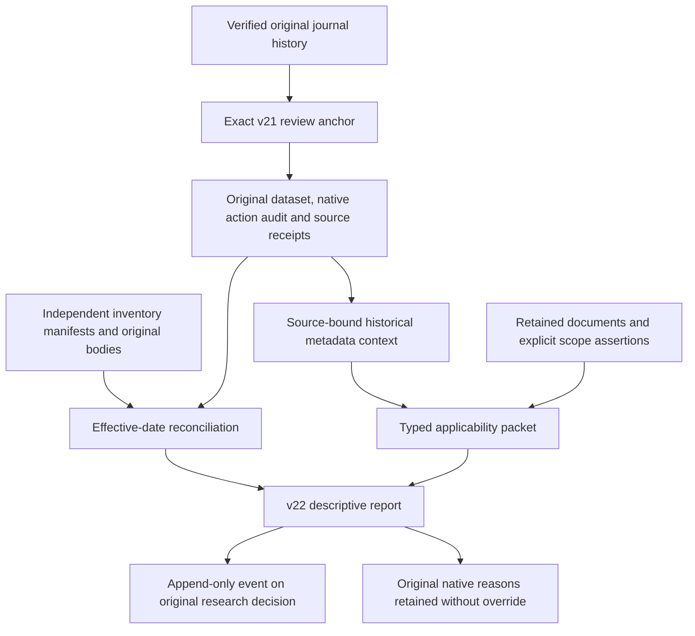

# Independent effective-date and historical applicability evidence

This offline v22 review compares retained independent action inventories with
the original native action audit and checks explicitly declared historical feed
and cost applicability scopes. It records discrepancies and missing evidence.
It does not replace a native qualification, change an old source, activate a
policy or submit an order. Auto-trading remains **OFF**.

The original v21 review, v20 qualification, dataset, prices, hypotheses, capture
plan, risk review and cost policies remain immutable. Investment and capital
allocation authority are untouched. Galactica trading rules are not reused.

## Source relationships



One strict combined request binds an exact v21 anchor, an effective-date request
and a historical feed/cost packet. Each source reference retains its exact path,
SHA-256 and byte size. URLs are provenance declarations; no command fetches them.
Clocks and cutoffs are explicit. Unknown historical facts stay unknown.

## Effective-date reconciliation

The request binds the exact governed dataset and native continuity export plus
one or more independent inventory manifests. An inventory preserves its
publisher, source URL, capture clock, original body and support leaves. Its
coverage declaration identifies symbols, action types, calendar dates and a
completeness claim. A claim of `DECLARED_COMPLETE` does not establish verified
completeness or authenticated source independence.

Supported source profiles are the retained SSGA historical-distributions XLSX
workbook and explicitly authored synthetic JSON actions. The workbook is a
distribution source; it cannot establish all corporate-action types or complete
QQQ coverage. The authored profile is a fixture, never a real issuer capture.

The report retains matching, native-only and independent-only rows, ambiguous
groups, conflicting values, unknown dates and scope gaps. Scheduled, cancelled
and revised entries remain distinguishable from effective actions. Process,
effective/ex, record and payable dates are different evidence. A scheduled date
does not prove an action occurred. Unknown dates are not assigned a guessed
effective session. Before/after-dataset observations remain visible.

Coverage retains every dataset symbol and all thirteen native action types.
Matching observed rows or a complete empty inventory cannot prove no unobserved
actions exist. A separately retained legacy-compatible coverage proposal is
always `UNRESOLVED` and is never applied automatically.

Independent rows do not enter the old native continuity masks. The existing
native intake derives events only from its original provider pages. A missing
independent action must remain a discrepancy until a separately governed native
source version incorporates it; this review never fabricates a provider row,
adjusts a price or rewrites an old review.

## Historical feed and cost applicability

Export the source context before authoring its packet. It binds the original
dataset, historical bars receipt, capture plan and quote receipts. It separates
market-event time from retrospective delivery time and preserves the literal
ALPACA / IEX / USD / market-data-only collection metadata.

The declared evaluation target can be `SHADOW_RESEARCH`, `PAPER_SIMULATION` or
`LIVE_BROKERAGE`. This is a research applicability question, never an execution
mode switch. Market-data access does not prove a paper/live brokerage account or
its fee arrangements. An optional redacted account-evidence reference remains
opaque and unauthenticated; credentials are never required.

All five categories are explicit:

| Category | Question retained |
| --- | --- |
| FEED_IDENTITY | Does the declared source describe the actual feed and endpoint? |
| QUOTE_SIZE_UNITS | Which units and historical/event versus delivery dates does the source describe? |
| FEE_SCHEDULE | Which account, side, currency, effective period and formula does the source claim? |
| SLIPPAGE | Is a source observation applicable to the declared historical target? |
| OPENING_CAPACITY | Is there applicable opening execution evidence beyond quote size or daily volume? |

Source assertions retain numeric tokens and claimed formula shapes without
converting them into parameters. Conflicting assertions, mismatched feed or mode,
missing account evidence and uncovered event/delivery periods remain explicit.
Current documentation is not silently applied to historical data. SIP/NBBO
simulator descriptions do not establish historical IEX fills. A documented size
change cannot automatically convert old native units into shares. Missing fees,
slippage or capacity are not replaced by zero.

`DECLARED_SCOPE_MATCHED_NOT_VERIFIED` describes a matching declaration, not
authenticated applicability. The report cannot populate old training
assumptions, estimate fill capacity, clip wide spreads, relax a model bound,
compute strategy returns or establish economic support. The original native
status and reasons are retained as a snapshot, not recomputed as a new decision.

## CLI lifecycle

Every command is offline. Use the existing Python environment from the repository
root. Store outputs outside source trees, runtime storage, canonical mission
storage and journal directories. Existing output files are immutable.

First run the authored example:

```sh
PYTHONDONTWRITEBYTECODE=1 PYTHONPATH=src:tests .venv/bin/python3.11 -m blackpod_build_week.evidence_reconciliation_example --output-root output/independent-evidence-example-002
```

It preserves twenty-two original fixture events, adds a single small native
source chain through v21 (39-event prefix), and appends three descriptive v22
reviews. The empty-inventory case means no observed rows, not proof of complete
coverage. The other cases retain an independently missing action, partial scope,
SIP-versus-IEX and date-basis mismatch, duplicate-action ambiguity, missing paper
account evidence and conflicting fee claims. No provider or credential is used.
Its inherited toy qualification is ready for a shadow study design only; the
independent packets do not turn that design status into verified coverage,
applicability, statistical support or permission to execute.

`prepare` only validates and writes a request. It performs no journal read or
assessment and explicitly returns `source_history_verified=false`:

```sh
PYTHONDONTWRITEBYTECODE=1 PYTHONPATH=src:tests .venv/bin/python3.11 -m blackpod_build_week.evidence_reconciliation_cli prepare --review-id my-passive-review --recorded-at 2025-04-08T10:00:00Z --data-cutoff-at 2025-04-08T10:00:00Z --anchor-review-event-id EXACT_V21_ANCHOR_ID --declared-evaluation-mode SHADOW_RESEARCH --inputs output/independent-evidence-example-002/input/empty-observations.prepare-inputs.json --output output/independent-evidence-example-002/prepared/request.json
```

Replace the anchor placeholder with the v21 anchor from the generated request.
The inputs object contains exactly `effective_date_request_evidence`,
`applicability_packet_evidence` and nullable `account_profile_evidence`. All
authority flags and auto-trading are fixed false. Optional supersession links an
earlier same-anchor review without overwriting it.

For a new real packet, export its source metadata first:

```sh
PYTHONDONTWRITEBYTECODE=1 PYTHONPATH=src:tests .venv/bin/python3.11 -m blackpod_build_week.evidence_reconciliation_cli context --journal-root YOUR_JOURNAL --anchor-review-event-id EXACT_V21_ANCHOR_ID --recorded-at EXPLICIT_CUTOFF --declared-evaluation-mode SHADOW_RESEARCH --output YOUR_SOURCE_DIRECTORY/context.v1.json
```

An earlier frozen context and packet can be reused with a later outer review
cutoff. The required order is context clock ≤ packet cutoff ≤ packet recorded
clock ≤ combined cutoff ≤ combined recorded clock. Use that exact context file
reference in the applicability packet; later review clocks never rewrite it.
This avoids circular hashes: context first, packet second, combined request last. The context is metadata, not a trusted replay
cache. Optional context inputs contain only nullable `account_profile_evidence`;
use `--evidence-root` only when those redacted bytes are not already retained.

Assess, record or retry, inspect and verify explicitly:

```sh
PYTHONDONTWRITEBYTECODE=1 PYTHONPATH=src:tests .venv/bin/python3.11 -m blackpod_build_week.evidence_reconciliation_cli assess --request output/independent-evidence-example-002/input/empty-observations.request.json --journal-root output/independent-evidence-example-002/journal --output output/independent-evidence-example-002/reports/cli-assessment.json
PYTHONDONTWRITEBYTECODE=1 PYTHONPATH=src:tests .venv/bin/python3.11 -m blackpod_build_week.evidence_reconciliation_cli record --request output/independent-evidence-example-002/input/empty-observations.request.json --journal-root output/independent-evidence-example-002/journal
PYTHONDONTWRITEBYTECODE=1 PYTHONPATH=src:tests .venv/bin/python3.11 -m blackpod_build_week.evidence_reconciliation_cli show --journal-root output/independent-evidence-example-002/journal --event-id EXACT_V22_EVENT_ID
PYTHONDONTWRITEBYTECODE=1 PYTHONPATH=src:tests .venv/bin/python3.11 -m blackpod_build_week.evidence_reconciliation_cli verify --journal-root output/independent-evidence-example-002/journal
```

The example already records its reviews, so its `record` command is an exact
retry. `assess` writes a report without appending. An external packet uses an
explicit `--evidence-root`; already retained evidence requires no external files.

Typed loading follows only the effective-date request, inventory manifests,
applicability packet and context relationships. Inventory bodies, support files,
source documents and account bytes remain opaque to the loader. Apparent nested
references and URLs inside them are never followed. Loading is bounded to 8,192
distinct references and 64 MiB; hash/size conflicts, unsafe paths, symlinks and
hardlinks fail closed.

## Journal and verification boundaries

The event is `TRADING_INDEPENDENT_EVIDENCE_RECONCILIATION_RECORDED`, journal v22.
It retains the original research decision ID, exact v21/native source links, new
request/result/method pins and new independent source bytes. It does not
duplicate the quote corpus or create another decision history. Later reviews
append; deterministic identity makes exact retries idempotent and changed
content under the same ID a conflict.

All journal trust boundaries still perform full semantic verification. The new
engine does not recalculate millions of quotes per review category, but existing
v21 replay still occurs when verifying the source journal. Full real-history
verification remains expensive. Batch publication can reduce repeated suffix
scans; there is no persistent trusted verification cache or skipped evidence.

See [the validation record](INDEPENDENT_EVIDENCE_RECONCILIATION_VALIDATION.md) for
actual test commands, fixture versus retained-history results and remaining gaps.
