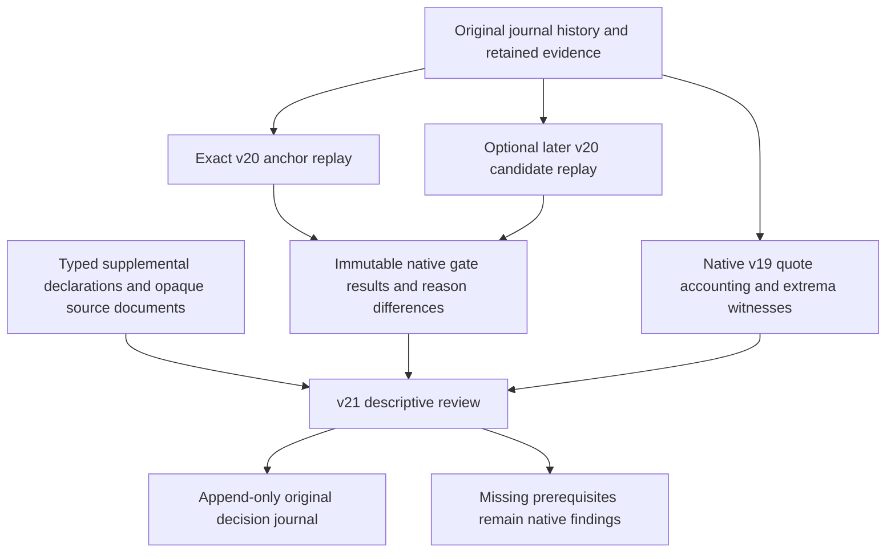

# Governed native evidence-closure review

The v21 review records what the existing native evidence gates say and which
immutable sources support those findings. It helps organize the remaining
research work. It cannot close a native prerequisite by checking a box, naming a
reviewer, supplying a URL, or changing a written summary.

This burst is offline and descriptive. Auto-trading remains **OFF**. There are
no provider calls, broker calls, model inference, order submission, capital
activation, policy changes, return scoring or automated approval in this path.
Galactica trading rules are not reused. Existing mission, ModelDock and Navigator
behavior is unchanged.

## Native results remain the authority for research eligibility

An anchor is an exact retained v20
`SEGMENTED_TRAIN_EVIDENCE_QUALIFICATION_RECORDED` event. Its whole original method
and source closure are replayed, including v18 policy, v19 capture plan and
aggregate export, historical dataset, hypothesis, and native continuity, cost
and risk records. The review retains its exact native result and hash.

An optional candidate must be a distinct later native v20 qualification with the
same original decision, base plan, dataset, hypothesis, evidence scope and exact
capture plan. It can select later evidence and a newly recorded native policy;
the review itself never modifies either policy or qualification. Resolved,
persisting and new reason codes are deterministic set differences between the
two exact native results. The selected candidate's reasons remain the missing
prerequisites. Without a candidate, the anchor's reasons remain unchanged.

`READY_FOR_QUALIFIED_STUDY_DESIGN` means eligibility to design a shadow research
study under declared controls. It does not establish a profitable hypothesis,
computed uncertainty, independently authenticated data, approval to trade or
approval to move capital. The new review always returns
`DESCRIPTIVE_REVIEW_ONLY`, `NOT_EXECUTED` and null realized trade P&L.



## Structured supplemental evidence

`NativeEvidenceSupplementalReview` binds the exact anchor and optional candidate
and requires exactly these ordered categories:

| Category | Native finding preserved |
| --- | --- |
| CONTINUITY | Original effective-date coverage and continuity windows |
| COST_CAPACITY | TRAIN quote extrema, declared fee/slippage inputs and capacity proxy |
| SHADOW_RISK | Original simulation-only sizing and joint-window review |
| UNCERTAINTY | Frozen protocol and feasibility; statistics remain uncomputed |
| WIDE_SPREAD | Exact native admission, extrema and descriptive component exceedances |

Each category is `UNRESOLVED` or `SOURCE_REVIEW_RECORDED`. The latter requires an
explicit source event or source document. Source event IDs must belong to the
selected native closure. Documents retain hash, size and exact opaque bytes;
optional source URL, capture clock and declared effective coverage are recorded
as unauthenticated metadata. Their content, reviewer label and applicability are
not authenticated. A supplemental document cannot cite itself as evidence.

The CLI loads only the typed supplemental document and its declared source
leaves. It never fetches URLs or follows apparent references inside opaque JSON,
text or binary source content. Up to 256 distinct references and 64 MiB of
declared evidence can be loaded; unsafe path traversal, symlinks, hardlinks,
conflicting path identities and hash/size mismatches fail closed. Exact
noncanonical source bytes remain retained even though the result contains their
validated canonical interpretation.

Source review does not replace independent native coverage. The provider's
corporate-action process-date filter, an empty successful page, or a complete
pagination chain cannot establish effective-date completeness. Clearing a
missing native continuity prerequisite requires a new source-bound native
intake and qualification policy with its original full-span coverage semantics.
Similarly, reviewed training assumptions and shadow risk remain native records;
reviewer declarations are not authenticated human approval or execution rights.

## Quote diagnostics preserve evidence rather than clean it

The diagnostic helper replays the selected v19 TRAIN export. It accounts for
every retained native quote under the original admission rule: positive bid,
ask and reported side sizes, noncrossed prices and exactly the regular `R`
condition in each frozen open-through-open-plus-60-second window. It does not
introduce a new strategy, sampling rule or exclusion threshold.

Raw, admitted and rejected totals reconcile to original native segment and fold
summaries. Rejection reason counts overlap when a row fails several predicates;
their sum is not the rejected-row count. Each symbol's maximum spread and
minimum reported side size has an exact body/receipt reference, source event,
row pointer, native timestamp and row hash. Number tokens are represented as
strings in witnesses to preserve their lexical precision; the retained raw
body remains authoritative. Deterministic ties select the first frozen segment,
page and symbol-array index.

The report counts admitted spreads strictly exceeding the existing 1,000 bps
cost-component bound at 1x, 2x and 4x. These counts are **spread-only** diagnostics,
not the full stressed cost model, a new trading rule or permission to remove
outliers. Extrema remain unclipped. Quotes cannot establish fees, slippage,
historical point-in-time authenticity, economic applicability or opening fill
capacity. Reported native size units and daily-volume research proxies do not
establish executable order sizes.

## Contracts and persistence

| Interface | Purpose |
| --- | --- |
| `contracts/native_evidence_closure.py` | Strict request, supplemental review, result and v21 event validators |
| `native_evidence_closure.review_native_evidence_closure(request, events, blobs)` | Pure replay and descriptive review material |
| `native_quote_diagnostics.diagnose_segmented_quotes(export_event, events, blobs)` | Deterministic original-admission quote accounting |
| `native_evidence_closure_journal.review_material(request, events, blobs)` | Original-parent v21 event and compact retained evidence |
| `native_evidence_closure_cli.load_review_evidence(request, retained, root)` | Bounded typed-leaf loading for an already verified source history |

Requests have an explicit review ID, recorded clock, data cutoff, exact anchor,
optional candidate, optional supplemental evidence and optional superseded
review. Domain, scope and mode are fixed to TRADING / native closure review /
SHADOW_RESEARCH. All four authority flags and auto-trading are false. The cutoff
must include every selected source. Candidate records must follow their anchor;
same-anchor reviews cannot backdate prior history. Supersession links an
unsuperseded review without moving cutoff or selected native progress backwards.

The single event type is
`TRADING_NATIVE_EVIDENCE_CLOSURE_REVIEW_RECORDED`, schema
`blackpod.decision_journal_event.v21`. It keeps the original decision ID and links
the exact selected policy, base plan, hypothesis, capture and export. Deterministic
identity derives from the original decision, event type and review ID. Reusing
that identity with changed content conflicts. Exact retries select the original
prefix, even after later linked reviews. Outcomes and evaluations append; no
original decision or evidence is rewritten.

The event retains compact request, result, method pins and new supplemental
source bytes; it references the already retained raw quote corpus. Existing
append-only hash chaining, safe publication, interrupted-write recovery and
full semantic verification apply. This does not add a persistent trusted replay
cache. Full replay of the real corpus remains expensive.

## Runnable offline examples and CLI

Run from the repository root with the existing Python environment. The example
destination must be separate from source and journal storage.

```sh
PYTHONDONTWRITEBYTECODE=1 PYTHONPATH=src:tests .venv/bin/python3.11 -m blackpod_build_week.native_evidence_closure_example --output-root output/native-evidence-closure-example-001

PYTHONDONTWRITEBYTECODE=1 PYTHONPATH=src:tests .venv/bin/python3.11 -m blackpod_build_week.native_evidence_closure_cli assess --request output/native-evidence-closure-example-001/input/deceptive-checklist.request.json --journal-root output/native-evidence-closure-example-001/journal --output output/native-evidence-closure-example-001/reports/cli-assessment.json

PYTHONDONTWRITEBYTECODE=1 PYTHONPATH=src:tests .venv/bin/python3.11 -m blackpod_build_week.native_evidence_closure_cli record --request output/native-evidence-closure-example-001/input/deceptive-checklist.request.json --journal-root output/native-evidence-closure-example-001/journal

PYTHONDONTWRITEBYTECODE=1 PYTHONPATH=src:tests .venv/bin/python3.11 -m blackpod_build_week.native_evidence_closure_cli verify --journal-root output/native-evidence-closure-example-001/journal
```

The example publishes all four reviews. The `record` command above is therefore
an exact no-op retry; `assess` exports a result without an append. Before a new
review, `prepare` writes a strict request and verifies source identities without
performing the review:

```sh
PYTHONDONTWRITEBYTECODE=1 PYTHONPATH=src:tests .venv/bin/python3.11 -m blackpod_build_week.native_evidence_closure_cli prepare --journal-root output/native-evidence-closure-example-001/journal --review-id my-new-descriptive-review --recorded-at 2025-04-09T10:00:00Z --data-cutoff-at 2025-04-09T10:00:00Z --anchor-qualification-event-id EXACT_RETAINED_V20_EVENT_ID --output output/native-evidence-closure-example-001/prepared/request.json
```

Replace the anchor placeholder with a retained native qualification ID from the
manifest. Optional flags are `--candidate-qualification-event-id`,
`--supersedes-event-id` and `--inputs`. The inputs file must contain only
`{"supplemental_review_evidence": null}` or an exact evidence reference. For
external supplemental sources, add `--evidence-root` to `assess` or `record`.
Already retained sources require no external files. `show --journal-root ...
--event-id ...` reads an exact v21 review. No command activates policy, captures
data, calls a provider or submits an order.

The authored example preserves the unchanged 84-event prior fixture. It adds
one later clean native candidate, 12 separately authored wide-observation
segment exports and their aggregate, a native wide candidate, and four v21
reviews: 103 events total. A deliberately complete checklist leaves missing
native coverage deferred; a genuinely changed native candidate resolves only
its native reasons; a new wide observation creates a native cost-bound
deferral; a partial capture remains incomplete. Original raw quote bodies, bars,
hypotheses and rules remain byte-identical. The wide observation is explicitly
synthetic and does not assert a provider capture or authenticated approval.

See [the validation record](NATIVE_EVIDENCE_CLOSURE_VALIDATION.md) for exact tests,
real-source diagnostics, remaining prerequisites and the recommended next burst.
