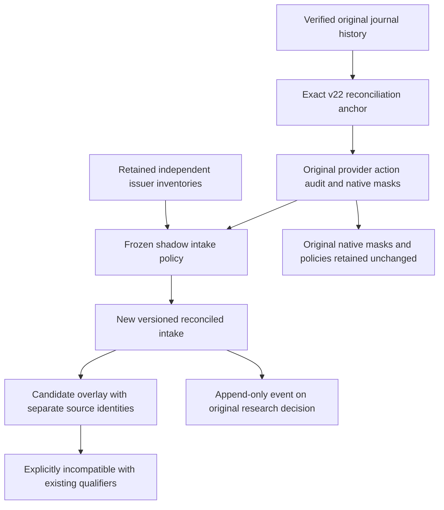

# Governed reconciled action intake

This offline research intake combines separately identified provider and issuer
observations under a frozen, versioned policy. Its output is a new candidate
overlay. It does not rewrite provider records, original native masks, prices,
policies or qualification results. Auto-trading remains **OFF**.

The policy status `FROZEN_FOR_SHADOW_INTAKE` means that its exact sources and
rules are fixed. It does not authenticate a reviewer or authorize execution,
policy activation or capital movement. Historical IEX normalization, account
fees, slippage, opening capacity, risk review and uncertainty remain independent
prerequisites.

## Source and authority boundaries



Provider and issuer observations keep their original identities and evidence.
Matching keys do not merge away source provenance. An issuer-only observation
is not a fabricated Alpaca action. Missing, conflicting, duplicate, unknown-date
or ambiguous observations remain visible under the frozen admission rules.
The SPY `2026-09-18` discrepancy is evidence to investigate; this intake does not
assert that a listed observation proves an action occurred.

A cash-distribution inventory cannot prove complete coverage of all thirteen
corporate-action types. Positive matches do not establish source authentication,
independence, historical point-in-time availability or a complete calendar.
Uncovered symbol/type/date scopes remain explicit. No prices are adjusted and
no return, economic support, executable order or realized P&L is manufactured.

## Independent QQQ source

The new QQQ profile is separate from the immutable v22 inventory profiles. It
binds the publisher-disclosed Invesco distribution resource for QQQ/CUSIP
`46090E103`, the retained response body, its capture receipt and product-page
discovery evidence. Only those typed references are followed; URLs and apparent
references inside raw documents are never fetched or traversed.

The parser retains the complete original body and row provenance, preserving
numeric JSON tokens as strings instead of rounding them through floating point.
Rows outside the declared date interval remain distinguishable. The declaration
covers only QQQ cash dividends and retains completeness `UNKNOWN`.
The normalized generic cash-distribution field `amount_lexemes.dividend` retains
`distributionAmountPerUnit`, the total distribution. The original
`ordinaryIncomeDistribution` and capital/other components remain separately
available in the literal row; no tax characterization or payment is inferred.

The QQQ body, receipt and discovery source have explicit per-file bounds. The
CLI also bounds the combined typed evidence closure and rejects unsafe paths,
symlinks, hardlinks and conflicting path/hash identities. Loading source bytes
is not source authentication.

## Frozen policy and append-only lifecycle

The policy binds an exact v22 anchor, the original dataset and provider export,
an exact canonical copy of the old native continuity masks, and explicit
independent inventory versions. All previously selected v22 inventories remain
included. A new source or different rule requires a new policy; an assessment
cannot silently substitute later evidence.

Preparation writes a separate policy bundle before registration. Derived native
mask bytes and new source leaves are retained alongside the policy without
circular references. Request preparation is schema-only; registration,
assessment, recording, showing and verification use the verified journal trust
boundary. Assessment writes a report without appending. Later intakes append
and link to the original decision.

The public CLI is offline and exposes no provider, credential, inference,
activation or order options. Journal events use deterministic identities;
exact retries write nothing and changed content under an existing identity is
a conflict. Interrupted publication preserves a valid immutable prefix that can
be retried. Full semantic replay remains required; there is no persistent
trusted verification cache.

Runnable commands and actual test, fixture and retained-history results are
recorded in [the validation record](RECONCILED_ACTION_INTAKE_VALIDATION.md).

## Runnable offline example

Run from the repository root using the existing environment:

```sh
PYTHONDONTWRITEBYTECODE=1 PYTHONPATH=src:tests .venv/bin/python3.11 -m blackpod_build_week.reconciled_action_intake_example --output-root output/reconciled-action-intake-example-001
```

The example keeps its original SYNTHA/SYNTHB universe and forty existing source
events, including all twenty-two original fixture events. It adds one frozen
policy and one candidate intake. The authored inventory contains eight
observations covering issuer-only, duplicate/conflicting, unknown-date,
scheduled/cancelled and outside-span cases. It is not an Invesco capture or a
claim of real QQQ coverage.

Prepare a policy bundle from the exact anchor ID in `manifest.json`:

```sh
PYTHONDONTWRITEBYTECODE=1 PYTHONPATH=src:tests .venv/bin/python3.11 -m blackpod_build_week.reconciled_action_intake_cli prepare-policy --journal-root output/reconciled-action-intake-example-001/journal --anchor-review-event-id journal-event-52639297e2766f91f410da27e9f37be4cfa233a092d22fce04e1dc3628b44187 --policy-id authored-frozen-reconciled-policy --recorded-at 2025-04-09T10:00:00Z --inputs output/reconciled-action-intake-example-001/input/policy-prepare-inputs.json --output-directory output/reconciled-action-intake-example-001/policy-bundle
PYTHONDONTWRITEBYTECODE=1 PYTHONPATH=src:tests .venv/bin/python3.11 -m blackpod_build_week.reconciled_action_intake_cli register-policy --policy output/reconciled-action-intake-example-001/policy-bundle/reconciled-actions/policy.v1.json --evidence-root output/reconciled-action-intake-example-001/policy-bundle --journal-root output/reconciled-action-intake-example-001/journal
```

The policy inputs object contains exactly `independent_inventories`. Include all
original v22 inventory references as well as any new inventory. An explicit
`--evidence-root` supplies source bytes not already retained. The output bundle
is separate from that source directory and the journal; it contains the policy
at `reconciled-actions/policy.v1.json`, derived original masks and required new
evidence. Registration in the example is an exact retry because generation
already recorded the policy.

Prepare and assess the existing example request without changing the journal:

```sh
PYTHONDONTWRITEBYTECODE=1 PYTHONPATH=src:tests .venv/bin/python3.11 -m blackpod_build_week.reconciled_action_intake_cli prepare --intake-id authored-reconciled-intake --recorded-at 2025-04-10T12:00:00Z --data-cutoff-at 2025-04-10T11:00:00Z --inputs output/reconciled-action-intake-example-001/input/intake-prepare-inputs.json --output output/reconciled-action-intake-example-001/prepared/request.v1.json
PYTHONDONTWRITEBYTECODE=1 PYTHONPATH=src:tests .venv/bin/python3.11 -m blackpod_build_week.reconciled_action_intake_cli assess --request output/reconciled-action-intake-example-001/prepared/request.v1.json --journal-root output/reconciled-action-intake-example-001/journal --output output/reconciled-action-intake-example-001/reports/cli-assessment.v1.json
```

Request preparation inputs contain exactly `policy_event_id`, `policy_evidence`
and nullable `supersedes_event_id`. Preparation reports
`source_history_verified=false`; it does not imply that a policy is registered
or its sources authenticated. The source and policy clocks must precede the
intake cutoff; later clocks cannot replace frozen evidence.

Record or retry, show an exact policy/intake ID from the manifest, and verify:

```sh
PYTHONDONTWRITEBYTECODE=1 PYTHONPATH=src:tests .venv/bin/python3.11 -m blackpod_build_week.reconciled_action_intake_cli record --request output/reconciled-action-intake-example-001/input/request.v1.json --journal-root output/reconciled-action-intake-example-001/journal
PYTHONDONTWRITEBYTECODE=1 PYTHONPATH=src:tests .venv/bin/python3.11 -m blackpod_build_week.reconciled_action_intake_cli show --event-id journal-event-bcaf95aae6d70f0e753cd45a17ddeaf373c07371f98b92679833650338b7c5b4 --journal-root output/reconciled-action-intake-example-001/journal
PYTHONDONTWRITEBYTECODE=1 PYTHONPATH=src:tests .venv/bin/python3.11 -m blackpod_build_week.reconciled_action_intake_cli verify --journal-root output/reconciled-action-intake-example-001/journal
```

All outputs are immutable. Protected source, Git, runtime, mission and journal
destinations fail before expensive verification. Typed source loading shares a
bound of 8,192 references and 64 MiB; raw documents are never recursive reference
containers. The separate QQQ parser retains its stricter body/receipt/discovery
limits. No command accepts a provider connection or an execution switch.
