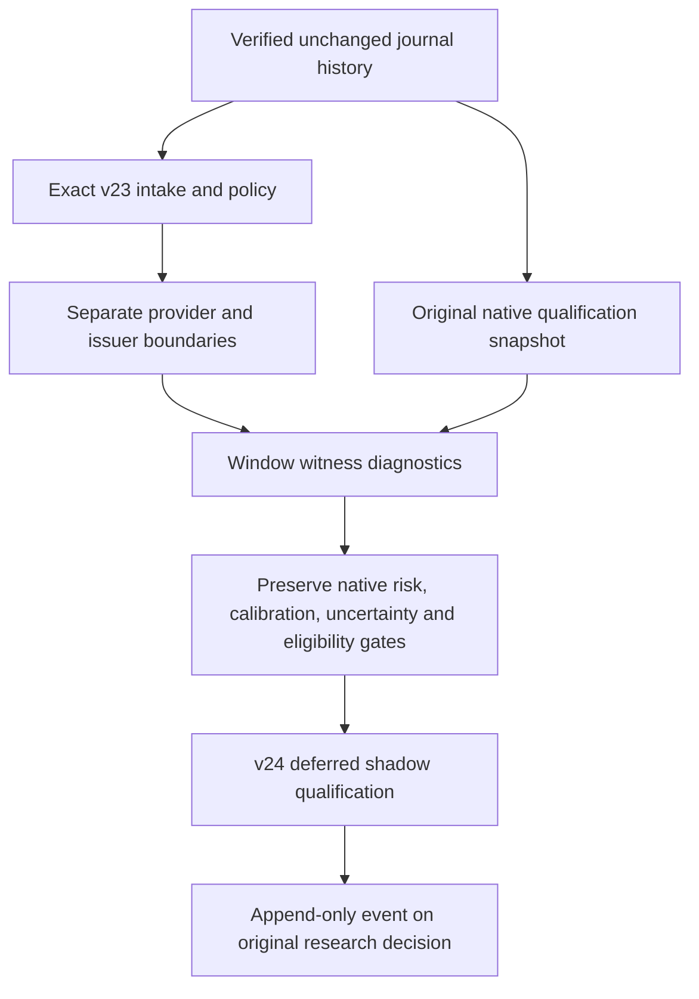

# Reconciled overlay shadow qualification

This versioned offline consumer assesses an exact recorded reconciled-action
intake against its unchanged native qualification. It adds diagnostic window
witnesses and vetoes; it cannot clear an original native gate. Auto-trading
remains **OFF**.

The request fixes the intake event and exact retained result hash. Its policy,
dataset, original native mask fragment, coverage matrix and boundary catalog
remain bound to that source. A later source, different policy or changed result
requires a new explicit record. There is no latest-source fallback or source,
coverage, cost, risk or authority override.

The request schema is `blackpod.reconciled_shadow_qualification_request.v1`;
the result and method are `blackpod.reconciled_shadow_qualification.v1`. Journal
v24 records `TRADING_RECONCILED_SHADOW_QUALIFICATION_RECORDED` on the original
research decision. The result retains the exact v23 policy, intake result and
original native snapshot hashes. `qualification_material(request, events,
blobs)` constructs the event without writing; the journal store establishes
the full-history trust boundary before publication and on replay.



## Window semantics

The consumer retains each original native opportunity. It associates relevant
boundary identities with feature, entry and holding/exit intervals. Candidate
witnesses use the affected symbol; benchmark witnesses consider the whole
original universe. Unknown dates retain their affected-symbol scope and do not
acquire a guessed session or a first-session placeholder.

For the original feature start `f`, completed source session `s`, entry `e` and
exit `x`, a known boundary at returned session `j` is associated with feature
history when `f < j <= s`, entry when `s < j <= e`, and holding/exit when
`e < j <= x`. The fixed-universe control uses `s < j <= x`. Unknown non-cancelled
dates veto all affected candidate windows and all controls containing that
symbol. Cancelled declarations remain visible but inactive. Original clock
failures and exits outside TEST remain deferred rows rather than disappearing
from the inventory.

A proposed boundary can restrict a diagnostic window without proving an action
occurred or was paid. Cancelled, scheduled, outside-span and unknown-date rows
remain distinguishable in the unchanged source catalog. Matching provider and
issuer observations retain separate identities.

Diagnostic cleanness is not study eligibility. Counts distinguish a window with
an overlay veto from a formerly native-eligible window newly vetoed by that
overlay. Native rejection, missing source coverage, cost/capacity evidence,
risk review and uncertainty remain gates. A null risk determination is not
silently treated as approval.

The calculation bounds the original opportunity inventory to 10,000 rows,
the boundary catalog to 30,000 rows, their comparisons to 2,000,000, and the
serialized result to 16 MiB. It rejects oversized inputs rather than silently
sampling, clipping or dropping witnesses. These are resource limits, not
trading thresholds.

Current reconciled intake coverage is unresolved, so the result remains
`DEFER_RECONCILED_SHADOW_QUALIFICATION` and all effective study eligibility stays
false. The original final holdout is retained. No signals, strategy returns,
cost estimates, unit multipliers, price adjustments or execution instructions
are produced. Execution stays `NOT_EXECUTED` with null realized trade P&L.

## Offline CLI

The five commands are `prepare`, `assess`, `record`, `show` and `verify`.
Preparation validates a strict request without reading or claiming verified
history. Assessment and recording first verify the source journal; assessment
writes an immutable report without appending. Recording uses ordinary immutable
journal publication. `show` requires an exact v24 event ID.

The preparation inputs object contains exactly `intake_event_id`,
`intake_result_evidence` and nullable `supersedes_event_id`. All authority flags
and auto-trading are fixed false. Optional external evidence loading follows
only the typed intake result, policy, dataset and original mask leaves. It does
not traverse source inventories, raw documents or URLs. Registered sources
normally need no external evidence root.

Outputs must be separate from source trees, runtime storage, canonical mission
storage and the journal. Existing files are immutable. The shared reader bounds
the evidence closure to 8,192 references and 64 MiB and checks safe paths,
regular files, link safety, hashes and sizes. Protected destinations fail before
expensive history verification. No command accepts provider, credential,
activation or execution options.

Exact retries write nothing. Changed content under an existing identity is a
conflict. Later evaluations or qualifications append without rewriting source
records. An interrupted valid journal prefix can be retried. Full semantic
verification remains required; no persistent trusted cache is introduced.

## Authored example

```sh
PYTHONDONTWRITEBYTECODE=1 PYTHONPATH=src:tests .venv/bin/python3.11 -m blackpod_build_week.reconciled_shadow_qualification_example --output-root output/reconciled-shadow-qualification-example-001
```

The example preserves all forty-two v23 fixture events, including the original
twenty-two source events, and appends one v24 qualification. It does not change
the SYNTHA/SYNTHB universe, source actions, prices, hypotheses or frozen policy.
Its unknown-date SYNTHB observation demonstrates that a benchmark can be vetoed
even when another symbol has no candidate-specific boundary witness. None of
those diagnostics establishes eligibility or economic support.

Current v23 coverage flags are deliberately fixed false. A fuller issuer
inventory or a positive match cannot toggle them. Admission of coverage would
require a separately governed, versioned review and new policy/contract tests;
this consumer does not supply that bridge.

After generating that example, these commands prepare the same frozen request,
write a separate assessment report, retry the existing event and verify the
journal. The `record` command returns `written: false` for this exact retry.

```sh
PYTHONDONTWRITEBYTECODE=1 PYTHONPATH=src:tests .venv/bin/python3.11 -m blackpod_build_week.reconciled_shadow_qualification_cli prepare --qualification-id authored-reconciled-shadow-qualification --recorded-at 2025-04-11T12:00:00Z --data-cutoff-at 2025-04-11T11:00:00Z --inputs output/reconciled-shadow-qualification-example-001/input/prepare-inputs.json --output output/reconciled-shadow-qualification-example-001/prepared/request.v1.json
PYTHONDONTWRITEBYTECODE=1 PYTHONPATH=src:tests .venv/bin/python3.11 -m blackpod_build_week.reconciled_shadow_qualification_cli assess --request output/reconciled-shadow-qualification-example-001/prepared/request.v1.json --journal-root output/reconciled-shadow-qualification-example-001/journal --output output/reconciled-shadow-qualification-example-001/reports/assessed.v1.json
PYTHONDONTWRITEBYTECODE=1 PYTHONPATH=src:tests .venv/bin/python3.11 -m blackpod_build_week.reconciled_shadow_qualification_cli record --request output/reconciled-shadow-qualification-example-001/prepared/request.v1.json --journal-root output/reconciled-shadow-qualification-example-001/journal
PYTHONDONTWRITEBYTECODE=1 PYTHONPATH=src:tests .venv/bin/python3.11 -m blackpod_build_week.reconciled_shadow_qualification_cli show --event-id journal-event-c6861fdfe552d4605d3cdcc215f36b17e921189eb9a19c03aaa175a7680f3fa7 --journal-root output/reconciled-shadow-qualification-example-001/journal
PYTHONDONTWRITEBYTECODE=1 PYTHONPATH=src:tests .venv/bin/python3.11 -m blackpod_build_week.reconciled_shadow_qualification_cli verify --journal-root output/reconciled-shadow-qualification-example-001/journal
```

The `show` command uses the authored fixture's deterministic event ID. For a
different request, use the exact ID returned by `record`. The authored example
never reads credential files, calls a provider
or starts a worker. Its fixed clocks label a synthetic chronology and make no
historical availability claim.

See [the validation record](RECONCILED_SHADOW_QUALIFICATION_VALIDATION.md) for
actual commands, test results, fixture versus retained-real coverage and limits.
