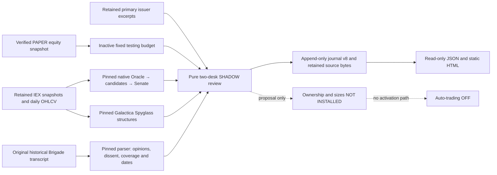

# Shadow two-desk candidate review and bounded PAPER test plan

This burst connects existing analytical capabilities to a separate, explicit
SHADOW review. It recommends a research shortlist, proposed desk ownership and
bounded test sizes from retained evidence. It does not install those proposals,
activate the budget, start a mission, call ModelDock, or enable auto-trading.

The operation has three separate domains: **TRADING**, **INVESTMENT**, and
**CAPITAL_ALLOCATION** oversight. A review spanning both desks is recorded as
`CAPITAL_ALLOCATION` journal v8, with all four authority fields false. This is
oversight research, not capital authorization. Auto-trading remains **OFF**.

## Capital basis and proposed sizing

The user declared a fixed testing cap of 25% of the captured PAPER equity,
split equally between the two desks. The existing source-bound budget records
the October 12, 2026 capture of **$81,525.11** equity:

| Scope | Recorded amount |
| --- | ---: |
| Testing cap | $20,381.27 |
| TRADING | $10,190.63 |
| INVESTMENT | $10,190.63 |
| Unassigned within testing | $0.01 |
| Outside testing | $61,143.84 |

The budget remains `DECLARED_INACTIVE` / `NOT_INSTALLED`. These fixed amounts
come from equity, not buying power. They do not cause continuing 50/50
rebalancing, capital transfers, or budget activation. The earlier initial
50/50 capital-policy proposal is retained separately and remains inactive.

The example review policy proposes a 10% TRADING entry cap, a 0.25% TRADING
scenario-loss allowance, a two-ATR stop scenario and a 1% ask-price buffer.
They are new **proposed SHADOW parameters**, not existing live trading rules or
user authorization to submit an order. With the recorded budget, the entry
cap is $1,019.06 and the scenario allowance is $25.47, rounded down to cents.

Whole-share size is the floor of the smaller of entry cap divided by buffered
ask and scenario allowance divided by stop distance. A nonpositive or
unaffordable size produces `DEFER`. The proposed test permits one active
entry, one completed entry/exit cycle and a 30-minute time exit. Its stated
purpose is execution and accounting validation; expected return remains null.
A stop scenario is not a maximum-loss guarantee, and a buffered market price
is not a guaranteed fill cap.

INVESTMENT proposals retain a declared horizon, research hypothesis and
invalidation conditions. The example policy uses 90 days and at most three
20%-of-desk research slices, with remaining capital shown as cash. Expected
returns remain null. Issuer mandates and price trends alone do not establish
fundamental value, an investment edge, or allocation authority.

## Connected evidence and authority



`shadow_native_analysis.py::derive_native_analysis` replays selected pure
definitions from a fixed, reviewed 24-file Battlestar source closure. It uses
the actual native normalizer, Oracle measurement/diagnostic/assessment/
narrative/report functions, trading candidate generator, Senate intake and
Senate deliberation. Source hashes are checked before AST compilation; native
package initializers, operational entry points and provider imports are not
executed. The full original source files are retained as evidence.

Native `generated_at` fields use the frozen market capture as a logical clock
for deterministic replay. They do not attest wall-clock processing time. The
separate review's `recorded_at` preserves its submission time, and the Galactica
packet preserves its explicitly supplied generation time.

The normalized geometry uses a retained last trade, previous daily close and
current daily OHLCV, with original source timestamps. Oracle measures fourteen
core proxies from the observed 21-symbol fleet. Candidate and Senate results
share that Oracle ancestry. REVIEW/WATCH and FAVORABLE/MONITOR/UNFAVORABLE are
native attention and discussion labels, not orders. Their heuristic confidence
values remain labeled, and are not success probabilities or independent votes.
The adapter's input-completeness gate is not canonical mission readiness;
`freshness_ok` is false and prospective freshness checks remain separate.

The original connected mission graph remains Harbormaster → Oracle → Council
→ Governor → explicit operator approval → Navigator SHADOW plan. The new review
does not run or change that workflow. Governor PROCEED and an approved Navigator
SHADOW handoff remain distinct from permission to trade.

### Spyglass

`shadow_galactica_analysis.py::build_shadow_galactica_analysis` calls the actual
Galactica `spyglass.py::analyze_structure` with its native `SRConfig` and
`PatternConfig` over retained daily OHLCV. It preserves support/resistance
levels, breakout events and pattern facts. The approved source fingerprint,
Python major/minor version, pandas version and NumPy version are retained for
exact replay. Existing dependencies are used; installation is not automatic.

At least 60 prior daily bars are required; the analysis is bounded to the last
300. Unproven daily bars on the capture's UTC date are excluded while their
original bytes remain retained. Swing detection uses right-hand bars, so these
are retrospective structures. A native `confirmed` flag is a heuristic fact,
not a forecast probability or an intraday execution signal.

The separate `blackpod.shadow_spyglass_challenge.v1` recency screen uses a fixed
30-calendar-day lookback from the original market capture. Older pattern,
breakout and resistance facts remain visible with their source times. Recent
bearish patterns or downward breakouts, and insufficient resistance headroom
relative to the proposed stop scenario, can defer a TRADING pilot. This screen
does not alter Galactica's native rules or live policies.

### Brigade and predictive models

The retained Galactica producer `agents/blackwell_brigade.py` is fingerprinted
but **not imported or invoked**. The adapter calls the existing
`scripts/brigade_debrief.py::parse_log` only when an original transcript and
explicit source date/time are supplied. It preserves member opinions,
confidence labels, Senate votes, dissent, incomplete rows and declared model
identity. Parsing time and original analysis time remain separate. A date-only
source retains `DATE_ONLY_TIMEZONE_UNSPECIFIED`; no timezone or clock time is
invented. Old opinions are historical context, never current votes.

Fresh Brigade generation requires governed, current, source-bound forecast
inputs, an explicitly enabled inference boundary and validation of the original
model/provider relationship. This burst supplies none of those by inference
from a filename or historical transcript. When current inputs are absent, the
status remains `MISSING_CURRENT_FORECASTS_AND_INFERENCE` or
`HISTORICAL_INPUT_ONLY`. It does not invent Scout/Sentry/Advisor/Canary/Pathfinder
opinions or reconnect a legacy orchestrator. Armada's legacy file adapter is
not a connected forecasting model in this review.

## Source contracts, selection and journal replay

`DeskReviewInput` is `blackpod.shadow_two_desk_review.v1`. It binds one account,
one verified PAPER equity snapshot and exact budget, market, analysis and issuer
evidence descriptors. Its scope is `SHADOW_TWO_DESK_REVIEW_ONLY`; the policy
status is `PROPOSED_SHADOW_ONLY`. Unknown fields and unsupported authority fail
closed. `desk_review_sources.py` checks that market maps equal retained raw
provider maps and that issuer excerpts, source URLs and dates match retained
primary-source captures. Hashes establish byte identity, not economic truth or
provider attestation.

`desk_candidate_review.py::assess_desk_review` calculates Decimal price/quote
and history measures, preserves missing measures as null, and produces
TRADING_PILOT, INVESTMENT_RESEARCH, DEFER or EXCLUDE. TRADING research ordering
uses native attention, observed spread, feed dollar volume and symbol ties.
INVESTMENT research ordering uses the declared issuer exposure class. Neither
ordering estimates returns or claims that a symbol is permanently optimal for
a particular desk. IEX volume is not consolidated liquidity. Price observations
are not economic observations about financing, cash flows or valuation.

The research filters require complete measures, positive usable quotes,
positive ATR, spread at most 0.50%, and average IEX dollar volume of at least
$100,000. Quote/trade and review ages are bounded to 24 hours and completed
history age to five days. These are proposal filters, not an executable quote
freshness gate. An actual paper test still requires refreshed quotes, regular
session verification, consolidated account risk, confirmed ownership and
explicit authorization. ETNs such as VXZ and known corporate actions inside
the proposed horizon are excluded from the initial accounting scope.

`build_desk_review_event` creates `SHADOW_DESK_REVIEW_RECORDED` journal v8.
`evidence_for_desk_review` retains the submitted input, inactive budget, market
and issuer captures, native code closure, analysis packets and any historical
Brigade transcript. `JournalStore` rebuilds the report from retained evidence
on append and verified reads. Rehashing a fabricated quantity, price, native
state, Spyglass fact or dissent cannot bypass that replay.

Identical retries use the original historical journal prefix; changed inputs
under the same review identity conflict. Later reviews append new events and
leave earlier source bytes, proposed sizes and dissent unchanged. Copied
journals replay without the original sibling checkout or export files. Missing,
corrupt or changed source bytes fail closed. Native source upgrades require a
reviewed fingerprint change; arbitrary retained Python is never accepted as a
new executable analytical module merely because its hash is supplied.

## Complete Build Week module inventory

The inventory below covers the Python package's implemented module families.
Paths are under `src/blackpod_build_week/` unless marked `contracts/`. Present
code is distinguished from the path exercised by this burst. Tests and retained
artifacts establish interfaces; they do not establish operational performance.

| Module family and actual files | Implemented responsibility | Role in this burst |
| --- | --- | --- |
| `__init__.py`, `contracts/__init__.py`, `hashing.py`, `identifiers.py` | Package exports, canonical bytes, hashes and identifiers | Shared contract/integrity infrastructure; no separate analyst or decision vote |
| `battlestar_config.py`, `repository_state.py`, `preflight.py` | Explicit sibling settings, repository checks and producer preflight | Producer/operational tooling; no stage probe, native producer process or ModelDock preflight is run by the review |
| `contracts/mission_request.py`, `contracts/mission_snapshot.py`, `contracts/presentation.py`, `contracts/oracle_narrative.py`, `contracts/demo.py` | Canonical mission, presentation, narrative and historical demo contracts | Existing contracts preserved; review uses additive contracts without redefining canonical stages |
| `mission_initialization.py`, `mission_store.py`, `mission_transitions.py`, `mission_presentation.py`, `unified_mission_workflow.py`, `harbormaster.py` | Canonical mission state, orchestration, presentation and explicit commands | Connected existing mission architecture, separate from new passive review; journal commands remain explicit |
| `oracle_adapter.py`, `oracle_workflow.py` | Native Oracle process boundary and stage persistence | Existing producer preserved; reviewed pure native analytical definitions are reused through `shadow_native_analysis.py` instead of starting the stage |
| `council_adapter.py`, `council_workflow.py` | Native candidate/Senate/Council chain and persistence | Actual candidate and Senate pure functions reused; canonical Council workflow is not invoked or changed |
| `governor_adapter.py`, `governor_workflow.py`, `operator_adapter.py`, `operator_workflow.py` | Native disposition and explicit operator handoff gating | Existing authority boundaries retained; SHADOW research cannot manufacture or replace these decisions |
| `navigator_adapter.py`, `navigator_workflow.py` | Validated Navigator intake and SHADOW planning | Existing non-execution contract; not invoked by the candidate review |
| `oracle_enrichment_workflow.py`, `oracle_market_brief.py`, `oracle_brief_reader.py`, `narrative_diagnostics.py` | Bounded narrative generation, source-linked presentation and validation errors | Optional existing narrative seam; neither a current analytical vote nor inference invoked by this burst |
| `modeldock_client.py`, `modeldock_config.py`, `modeldock_preflight.py` | Existing explicit ModelDock service integration | Preserved and not called; model selection/configuration stays with ModelDock |
| `cabin_context.py`, `cabin_reader.py`, `navigator_catalog.py`, `navigator_fleet_catalog.py`, `navigator_reference_reader.py`, `navigator_live.py` | Read-only publication, captured charts, technical references and optional price overlay | Presentation/reference infrastructure, separate from decision authority; viewing it does not refresh or authorize the review |
| `sentry_reader.py`, `sentry_research_reader.py`, `sentry_scan_reader.py` | Explicit Sentry archive/research/scan presentation | Existing optional research views; not treated as connected independent votes in this review |
| `sentry_history_cache.py`, `sentry_history_recovery.py` | Bounded history validation, capture/recovery tooling and safe filesystem helpers | Safe read helpers reused; no history recovery, provider backfill or Sentry policy promotion is run |
| `demo_catalog.py`, `demo_terminal.py`, `demo_validation.py`, `demo_workflow.py`, `live_demo_packager.py` | Historical demonstrations, validation and packaging | Retained developer tooling; does not govern normal product startup or current desk analysis |
| `contracts/decision_journal.py`, `decision_journal_projection.py`, `decision_journal_store.py`, `decision_journal_cli.py` | Verified mission imports, mixed-version immutable journal and offline commands | Connected persistence/integrity path; new v8 records remain separate from source missions |
| `contracts/investment_hypothesis.py`, `contracts/investment_review.py`, `contracts/investment_governance.py`, `investment_hypothesis.py`, `investment_review.py`, `investment_governance.py`, `investment_approval.py` | Explicit hypotheses, independent declared challenge, fixed outcome comparisons and shadow governance | Existing separate research lifecycle, available for later thesis work; a candidate row does not silently create a historical hypothesis, evaluation or approval |
| `contracts/trading_automation.py`, `trading_automation.py` | Journaled control intent | OFF/BLOCKED intent is distinct from runtime execution permission |
| `auto_trading_cli.py`, `auto_trading_runtime.py`, `auto_trading_worker.py`, `galactica_trading_adapter.py`, `paper_account_safety.py` | Separate guarded PAPER execution controller, admission, persistent ownership and restart barriers | Implemented independent execution path; auto-trading stays OFF and no worker/broker mutation is started by this burst |
| `contracts/trading_reconciliation.py`, `trading_reconciliation.py`, `trading_reconciliation_cli.py`, `paper_account_probe.py`, `paper_order_capture.py` | Explicit read-only broker captures, ownership observations and receipt reconciliation | Existing account facts supply budget evidence; no order submission, cancellation or ownership installation is a review side effect |
| `contracts/trading_accounting.py`, `trading_accounting.py`, `trading_accounting_cli.py`, `paper_activity_import.py` | Retained individual fills/fees, long-only FIFO, append-only accounting | Existing outcome-accounting path reserved for actual attributable execution; this nonexecuted review has null realized P&L |
| `contracts/paper_test_budget.py`, `paper_test_budget.py` | Source-bound fixed inactive testing budgets | Connected budget basis; activation and transfers disabled |
| `contracts/desk_candidate_review.py`, `desk_candidate_review.py`, `desk_candidate_review_cli.py`, `desk_review_sources.py` | New strict review, pure proposals, evidence binding and explicit offline commands | Connected SHADOW two-desk analysis and journal projection |
| `shadow_native_analysis.py`, `shadow_galactica_analysis.py` | Pinned native analytical replay, Spyglass structures and optional historical Brigade parsing | Connected provider-free calculation; no fresh Brigade inference, training or legacy orchestrator |
| `desk_candidate_review_presentation.py`, `desk_review_example.py` | New static report and runnable synthetic evidence example | Read-only presentation and offline demonstration; no trading authority |

The UI's Admiral destination opens the recorded fleet; it is not an additional
analytical decision engine. Galactica Armada forecasts and legacy Senate CSV
readers are external legacy interfaces, not predictive models activated by this
burst. Existing Oracle temporal/story and Sentry studies remain supplemental
research artifacts with their original timestamps and caveats.

Modules cannot all be invoked just to claim utilization: several produce
missions, inference, provider calls, recovery writes, approvals or execution.
Others are contracts, presentations and mutually exclusive historical/demo
paths. The useful integration is an explicit evidence interface and honest
coverage/absence reporting. Forced invocation would cross authority boundaries
or count the same evidence repeatedly. Optional paths become current evidence
only after an explicitly configured source, validation and governing scope
exist.

## Runnable offline example

Run from the repository root using existing dependencies. The example is
explicitly synthetic; it is not the real account, real forecasts, broker
activity or performance. The output root is separate from source evidence and
mission storage.

```sh
PYTHONDONTWRITEBYTECODE=1 PYTHONPATH=src .venv/bin/python3.11 \
  -m blackpod_build_week.desk_review_example \
  --output-root output/auto-trading-shadow-desk-example

PYTHONDONTWRITEBYTECODE=1 PYTHONPATH=src .venv/bin/python3.11 \
  -m blackpod_build_week.desk_candidate_review_cli assess \
  --journal-root output/auto-trading-shadow-desk-example/journal \
  --review output/auto-trading-shadow-desk-example/review.json \
  --evidence-root output/auto-trading-shadow-desk-example/evidence

PYTHONDONTWRITEBYTECODE=1 PYTHONPATH=src .venv/bin/python3.11 \
  -m blackpod_build_week.desk_candidate_review_cli record \
  --journal-root output/auto-trading-shadow-desk-example/journal \
  --review output/auto-trading-shadow-desk-example/review.json \
  --evidence-root output/auto-trading-shadow-desk-example/evidence

PYTHONDONTWRITEBYTECODE=1 PYTHONPATH=src .venv/bin/python3.11 \
  -m blackpod_build_week.harbormaster journal verify \
  --journal-root output/auto-trading-shadow-desk-example/journal
```

Read the saved event identity for the explicit show/render commands. The file
contains a public journal identity, not credentials:

```sh
desk_review_event_id=$(cat output/auto-trading-shadow-desk-example/expected-event-id.txt)

PYTHONDONTWRITEBYTECODE=1 PYTHONPATH=src .venv/bin/python3.11 \
  -m blackpod_build_week.desk_candidate_review_cli show \
  --journal-root output/auto-trading-shadow-desk-example/journal \
  --event-id "$desk_review_event_id"

PYTHONDONTWRITEBYTECODE=1 PYTHONPATH=src .venv/bin/python3.11 \
  -m blackpod_build_week.desk_candidate_review_cli render \
  --journal-root output/auto-trading-shadow-desk-example/journal \
  --event-id "$desk_review_event_id" \
  --output output/auto-trading-shadow-desk-example-report/review.html
```

`assess` reads retained sources and computes a proposal. `record` appends the
immutable result; repeating the same input is an idempotent no-op. `show` reads
a verified event. `render` writes a separate static report and cannot alter the
journal or source files. Neither command implies current quote freshness, sets
an automation switch, installs ownership or submits an order. Exact executed
commands, actual versus fixture coverage and test results belong in the
[validation report](SHADOW_DESK_REVIEW_VALIDATION.md).

After a successful record, `assess` and an identical `record` retry can omit
`--evidence-root`: verified journal blobs retain the full source closure.
Output writes use an artifact lock and immutable publication. Existing
differing report bytes conflict rather than being overwritten; use a new
report filename when intentionally changing a presentation. Within a Git
checkout, this interface writes only beneath this package's ignored `output/`
tree, and rejects sibling source trees, mission/journal storage and installed
trading runtime storage.

For separately prepared real evidence, `prepare-analysis` accepts an existing
validated market packet and its retained evidence root, plus explicit read-only
Battlestar and Galactica source roots. It freezes the reviewed source closure
and writes a content-addressed analysis bundle into that separate evidence root.
It acquires no market data, reads no credentials and starts no inference:

```sh
PYTHONDONTWRITEBYTECODE=1 PYTHONPATH=src .venv/bin/python3.11 \
  -m blackpod_build_week.desk_candidate_review_cli prepare-analysis \
  --market /absolute/path/to/frozen/market-packet.json \
  --evidence-root /absolute/path/to/separate/evidence \
  --native-root /absolute/path/to/read-only/battlestar \
  --galactica-root /absolute/path/to/read-only/galactica \
  --generated-at 2026-10-12T21:00:00Z
```

The paths above require an explicitly captured source set; this is not a
replacement for the runnable synthetic example. Choose an explicit generation
timestamp at or after the frozen market capture. Historical Brigade import is
optional and requires both `--brigade-transcript` and `--brigade-as-of`.
A genuine date-only source accepts a date such as `2026-04-24` and keeps its
unknown timezone/clock precision. Omitting the pair leaves current Brigade
opinions unavailable. No launch script or model producer is called.

Before any later bounded PAPER entry/exit exercise, a separate authorization
must bind the reviewed symbols, desk ownership, fixed budgets, size limits,
expiry and account identity to the actual execution profile, followed by the
existing runtime/reconciliation/accounting checks. This document records the
SHADOW proposal interface; it does not implement that next burst.
