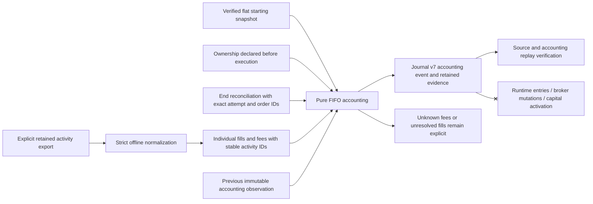

# Burst 6 — offline fill-lot and fee accounting

Auto-trading remains OFF. This layer imports retained execution activities,
replays long-only FIFO, and appends reproducible accounting observations. It
does not contact Alpaca, load native execution code, change a desk book, clear
a restart barrier, activate a capital policy, or enable a worker.

## Evidence and authority



`PaperActivitiesInput` contains individual fill IDs, exact order IDs, symbols,
sides, execution quantities, prices and timestamps. Fees have their own IDs,
signed amounts, timestamps or dates, and any source-provided fill/order links.
Positive amounts are charges; negative amounts are credits. The coverage
window, selected order IDs, fill completeness and fee completeness are explicit
import declarations. Original source bytes remain hash-bound evidence.

Alpaca describes individual executions in its
[account activity documentation](https://docs.alpaca.markets/us/docs/account-activities).
Its [regulatory fee documentation](https://docs.alpaca.markets/us/docs/regulatory-fees)
describes fees that can be accrued and charged later. An empty fee list alone
cannot establish zero cost. Account-level fees without an exact execution link
remain unallocated; this burst does not invent an allocation or hard-code rates.

`AccountingInput` links the starting snapshot, ending reconciliation, ownership,
activities evidence and optional previous accounting event by exact identities
and hashes. `TRADING_FILL_LOT_ACCOUNTING_RECORDED` is an additive journal v7
event. All execution, capital, policy and investment authority flags are false.
Its accounting identity is independent of canonical mission decisions.

The starting snapshot must support a flat scoped trading book. Existing broker
average entry prices cannot seed fictional historical lots. Only individual
activities tied to the exact retained PAPER execution receipts and ownership
can support attributable profit. A SHADOW handoff or a research approval never
becomes a fill, and a mission without execution never acquires realized P&L.

## Accounting method

The method is `FIFO_LONG_ONLY`, USD, with deterministic bounded decimal
arithmetic. Buy fills create lots. Sell fills consume the oldest eligible lots;
partial consumption preserves the remainder. A sale that exceeds retained
long holdings, missing transactions, uncertain order lineage, unsupported
activity or an ambiguous execution sequence cannot become a reconciled profit.
This burst does not support short lots or corporate-action adjustments.

Order observations provide cumulative quantity and ending-position checks;
they are never additional fills. Repeated identical activity IDs are
deduplicated. Conflicting facts for one ID reject. A later accounting
observation replays the cumulative retained activities from the same baseline
and links its predecessor. It cannot omit or rewrite prior fills or fees.

Fees linked to an exact fill or fully covered order are allocated by quantity.
The fixed precision policy uses precision 256 and scale 18 with HALF_EVEN
rounding; the final slice receives the remainder so allocated fees conserve the
source total. Each rounded slice is capped to the remaining signed fee, so a
tiny charge cannot produce a fictional rebate. Credits use the same rule.
Open-lot costs and closed-lot costs are
reported separately. Unknown or unallocated fees leave net realized P&L null.

The result distinguishes `RECONCILED`, `GROSS_RECONCILED_FEES_PENDING`,
`PENDING`, and `NO_EXECUTION_OBSERVED`. A complete attributable fill history can
support gross profit while fee evidence is pending. Fill or position gaps
withhold both gross and net profit. No execution leaves both null, including a
flat account with an explicitly empty activity list.

Covered individual fill values must also agree with the exact broker order's
filled quantity multiplied by its observed average price. A missing or
contradictory average withholds profit. This is a consistency check, never a
source of synthesized fills. An average rounded by the broker can cause a
conservative `PENDING` result; this version does not invent a price tolerance.
Every supported durable receipt's pre-order quantity must agree with the
source-backed fill history at that point. Unknown or contradictory receipt
positions and ambiguous same-time executions withhold profit.

Reproducibility means replaying the retained local evidence. Imported provider
identity, completeness and declared operator identities are not cryptographic
attestations. Sequential broker snapshots remain non-atomic. Original source
timestamp text is retained. Activity timestamps with more than six fractional
second digits reject, preserving evidence rather than truncating an execution
sequence; economically different equal-time fills remain pending. Preserve
native runtime archives for the full trading-decision
context. This accounting method is an operational evidence tool, not a tax-lot
or tax-reporting system.

## Offline commands

Use the checkout's existing interpreter and dependencies:

```sh
export PYTHONDONTWRITEBYTECODE=1
export PYTHONPATH=src

.venv/bin/python3.11 -m blackpod_build_week.trading_accounting_cli --help

.venv/bin/python3.11 -m blackpod_build_week.trading_accounting_cli normalize-activities \
  --export /absolute/path/to/declared-activity-export.json \
  --activity-set-id paper-test-activities-001 \
  --output output/auto-trading-accounting-inputs/activities.json

.venv/bin/python3.11 -m blackpod_build_week.trading_accounting_cli validate-activities \
  --activities output/auto-trading-accounting-inputs/activities.json \
  --source-evidence /absolute/path/to/declared-activity-export.json

.venv/bin/python3.11 -m blackpod_build_week.trading_accounting_cli assess \
  --journal-root output/auto-trading-accounting-example \
  --accounting /absolute/path/to/accounting-input.json \
  --activities output/auto-trading-accounting-inputs/activities.json \
  --source-evidence /absolute/path/to/declared-activity-export.json

.venv/bin/python3.11 -m blackpod_build_week.trading_accounting_cli record \
  --journal-root output/auto-trading-accounting-example \
  --accounting /absolute/path/to/accounting-input.json \
  --activities output/auto-trading-accounting-inputs/activities.json \
  --source-evidence /absolute/path/to/declared-activity-export.json

.venv/bin/python3.11 -m blackpod_build_week.harbormaster journal verify \
  --journal-root output/auto-trading-accounting-example
```

The linked snapshots, ownership and reconciliation must already exist in the
selected verified journal. `assess` performs no writes. `record` retains all
required source bytes and appends an event using the existing private,
append-only journal writer. Identical retries are no-ops; changed facts under
an existing identity reject. Once evidence is retained, retries can omit the
`--activities` and `--source-evidence` files. `show --journal-root ... --event-id
...` verifies and reads an accounting event.

Normalization has no API client. It accepts a versioned declared export, not an
unscoped provider response. Source directories and journal directories must
remain separate. Normalized output uses private no-replace writes; canonical
mission, journal and native/runtime source trees are protected.

## Runnable synthetic fee-update example

These inputs demonstrate two buys (2 at $10 and 3 at $12), a sale of 4 at $15,
one remaining share, and fees observed in a later import. All account, symbol,
profile and activity facts are synthetic; they are not a recommendation or an
installed real-account book. The profile paths explicitly identify
non-executable synthetic sources.

```sh
.venv/bin/python3.11 examples/trading_accounting/seed_journal.py \
  --journal-root output/auto-trading-accounting-example

.venv/bin/python3.11 -m blackpod_build_week.trading_accounting_cli record \
  --journal-root output/auto-trading-accounting-example \
  --accounting examples/trading_accounting.pending-fees.paper.v1.json \
  --activities examples/paper_activities.pending-fees.fixture.v1.json \
  --source-evidence fixtures/trading_accounting/activity-export.pending-fees.fixture.json

.venv/bin/python3.11 -m blackpod_build_week.trading_accounting_cli record \
  --journal-root output/auto-trading-accounting-example \
  --accounting examples/trading_accounting.complete-fees.paper.v1.json \
  --activities examples/paper_activities.complete-fees.fixture.v1.json \
  --source-evidence fixtures/trading_accounting/activity-export.complete-fees.fixture.json

.venv/bin/python3.11 -m blackpod_build_week.harbormaster journal verify \
  --journal-root output/auto-trading-accounting-example
```

The first accounting event records $16 gross realized profit and unknown net
profit. The second retains that original event, adds the known fees, records
$15.92 net realized profit and $0.01 of remaining entry fees in the open lot.
`totals.allocated_open_fees` is that known remaining lot cost; unmatched
account-level fees appear in `unmatched_fees` and prevent net profit. The two
committed expected event files reproduce byte-for-byte. Repeating the seed or
recording commands writes no new events.

## The declared real PAPER test budget

The user directed a testing envelope of 25% of current paper-account equity,
split equally between the desks. The confirmed October 12, 2026 capture at
19:36:38 UTC showed USD equity and cash of $81,525.11, no positions, and no open
orders. Buying power is not the basis for the budget.

| Scope | Fixed USD amount |
| --- | ---: |
| Testing cap, rounded down to cents | $20,381.27 |
| TRADING | $10,190.63 |
| INVESTMENT | $10,190.63 |
| Unassigned reserve within test cap | $0.01 |
| Outside the test | $61,143.84 |

`PaperTestBudget` v1 validates the ratios, cent rounding, exact conservation of
equity, source event/hash, disabled authority, and unset trial parameters.
The artifact is `DECLARED_INACTIVE` / `NOT_INSTALLED`, retained by a private
no-replace write and linked to a verified broker snapshot journal. It is a
separate artifact, not a journal event, activated policy, runtime budget or
capital transfer. Identical retries are unchanged; a changed declaration under
the same account/budget ID conflicts.

```sh
.venv/bin/python3.11 -m blackpod_build_week.trading_accounting_cli plan-paper-test-budget \
  --journal-root /absolute/path/to/verified-budget-source-journal \
  --snapshot-event-id EXACT_VERIFIED_PAPER_SNAPSHOT_EVENT_ID \
  --budget-id paper-testing-25-percent-20261012 \
  --recorded-at EXACT_DECLARATION_TIMESTAMP \
  --declared-by local-human-user \
  --confirm-account-id EXACT_CONFIRMED_ACCOUNT_ID \
  --output-root output/auto-trading-paper-test-budget

.venv/bin/python3.11 -m blackpod_build_week.trading_accounting_cli validate-paper-test-budget \
  --journal-root /absolute/path/to/verified-budget-source-journal \
  --budget /absolute/path/to/retained-budget-artifact.json
```

These are initial fixed budgets at the captured equity value. Changes require a
new explicit declaration; there is no perpetual percentage rebalance. Symbol
ownership, maximum entry size, total entry/exit test notional and expiry remain
unset. The desk budget does not authorize spending the entire amount on one
order. All real runtime controls remain OFF.

## Selection and the bounded paper test

BlackPod should recommend desk candidates from evidence. A ticker's suitability
depends on the hypothesis and horizon; it is not a permanent intrinsic desk
classification. A candidate can have both a trading setup and an investment
thesis. The current execution boundary requires disjoint symbol ownership
because its native exit path closes a whole symbol position.

The recommended next burst is a shadow two-desk candidate review that extends
the existing analytical evidence and deliberation interfaces. First verify
which Oracle, Senate, Brigade, technical and quantitative paths are connected;
then produce a source-bound comparison of available candidates, with technical
structure, liquidity and horizon for TRADING, and macro/fundamental thesis,
invalidation and portfolio implications for INVESTMENT. Missing evidence must
remain missing. Recommendations grant no execution authority.

That review can propose a bounded PAPER entry/exit plan with selected symbols,
protected investment scope, the declared fixed test budgets, maximum entry size, total
test notional, expiry, exits and recovery criteria. Explicit authorization must
bind the resulting plan before any order is submitted. The initial 50/50
capital policy remains PROPOSED; it is not a recurring rebalance or an activated
budget. This burst declares the separate 25% testing envelope, installs no
real-account ownership or runtime budget, and starts no
test or worker.

The user's hypothesis is that disciplined rules can improve returns over
manual trading. This accounting burst measures source-backed execution costs
and profit; it does not demonstrate that hypothesis. Its later evaluation needs
an explicit horizon, benchmark, preserved policy version, drawdown limits and
complete cost evidence. Outcomes alone cannot modify live rules.

For the paper trial, collect all owned-symbol/account activities over the test
window and establish exclusive execution. A selected-order export cannot prove
the absence of an external closed round trip between two flat snapshots.
Provider identity and completeness remain declared limitations. Accounting
continuations retain one baseline and ownership; a roll-forward checkpoint or
ownership transition for an accounting period is later work. Full replay is
bounded to 20,000 retained activities.

See [validation results](TRADING_ACCOUNTING_VALIDATION.md) for runnable fixtures,
actual commands, test counts, real-history coverage and remaining limitations.
