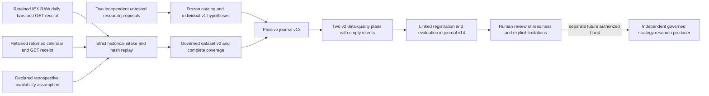

# Independent trading hypotheses and governed historical intake

This burst freezes two new **TRADING** research hypotheses and admits retained
daily market history through a strict, replayable evidence boundary. It uses
no Galactica trading rule, forecasting preset, Brigade vote, Navigator mandate,
stop or position-sizing policy. The hypothesis descriptions are original
proposals, not established economic effects or statistical proof of independence.
They could have correlated returns when eventually tested.

**Auto-trading stays OFF.** All hypothesis, intake, plan and journal authority
flags remain disabled. This work cannot submit orders, assign symbol ownership,
activate desk budgets, change an investment thesis, move capital, select a
winning strategy or promote a strategy into execution. The ordinary CLI reads
retained evidence; it has no credential access, capture client, provider call,
inference call or strategy producer.

## Frozen hypotheses

`contracts/trading_hypothesis.py` defines immutable
`TradingHypothesis` (`blackpod.trading_hypothesis.v1`) and
`TradingHypothesisCatalog` (`blackpod.trading_hypothesis_catalog.v1`). Unknown
fields and versions, changed formula parameters, coercion of booleans or
integers, and enabled authority are rejected. The catalog contains exactly the
two sorted specifications with one explicit author and recording clock.

| Proposed experiment | Frozen observation | Candidate condition | Proposed holding interval |
| --- | --- | --- | --- |
| Previous-session negative-return reversal | `close[t] / close[t-1] - 1` | Strictly below zero | 1 session |
| Five-session positive-return continuation | `close[t] / close[t-5] - 1` | Strictly above zero | 3 sessions |

The zero boundary, lookbacks and holding intervals are **predeclared proposed
values, not tuned or optimal values**. Zero return produces no candidate.
The first proposed mechanism is temporary selling pressure followed by
reversal; lasting adverse information is an explicit alternative. The second
is persistent demand or gradual information incorporation; overreaction and
passive market exposure are explicit alternatives. Both have testable expected
comparisons and falsification conditions, rather than a profitability claim.

The specifications require completed close inputs available before a decision,
next-session-open entry after availability, an exit opening following the
declared holding interval, and no overlapping/reentry positions. These are
frozen descriptions for a future research producer. **No code in this burst
calculates a signal, creates candidate decisions or executes those rules.**

Each hypothesis requires cash and a matched equal-gross-exposure control,
predeclared costs and cost stress multipliers of 1, 2 and 4. The existing
foundation implements only the cash comparison; the matched control is
honestly labeled `DECLARED_NOT_IMPLEMENTED`. Missing costs, availability or a
required control produce an inconclusive interpretation, never assumed support.
No benchmark return or performance value is invented here.

The requested metrics include net return and expectancy, drawdown, turnover,
exposure, closed-trade and rejection counts, and excess return against both
benchmarks. These are future evaluation requirements, not newly implemented
performance measures. Positive return against cash alone would not establish
a trading edge. Statistical uncertainty, minimum evidence requirements,
trial-selection corrections and promotion thresholds require separate
governed research work.

`trading_hypotheses.py::catalog_hypotheses(recorded_at, author_id)` is a pure
export. `catalog_documents(catalog)` returns individual immutable documents.
`hypothesis_research_strategy(hypothesis)` projects descriptive fields into the
existing research plan shape; it returns no intents, symbols, quantities,
forecasts, stops or budgets. Plan `EXTERNAL_INTENTS_ONLY` preserves the original
interface boundary and does not claim an implemented hypothesis producer.

Recording before a new capture freezes these proposals for that future local
workflow. It cannot prove that their author never saw earlier historical data.
Every record explicitly declares
`SPECIFICATION_FREEZE_ONLY_NOT_HISTORICAL_PREREGISTRATION`.

## Governed historical intake

`HistoricalIntakeRequest` binds the sorted fixed universe, requested calendar
dates, IEX/RAW data policy, explicit availability assumption and four distinct
evidence references: returned bars, bars GET receipt, returned calendar and
calendar GET receipt. `HistoricalIntakeExport` binds that request, all source
bytes, a derived dataset and complete session coverage.

The pure adapter in `trading_historical_intake.py` verifies hashes and lengths,
exact declared GET endpoints/query semantics, successful capture clocks,
regular and extended calendar clocks, timezone conversion and chronological
OHLCV. It consumes actual retained calendar rows, including early closes;
weekdays or a guessed holiday schedule cannot replace those rows. Numeric
tokens are parsed as bounded decimals rather than silently rounded binary
floats. Bar symbol/date coverage must agree with the source calendar and
request. Missing eligible bars, duplicate dates, malformed fields, unknown
sessions or unconsumed pagination fail verification. The v1 adapter accepts a
complete single-page response and does not invent a page it did not retain.

Dataset v2 distinguishes three facts:

- `recorded_at` and retained receipt clocks say when these bytes were captured.
- Modeled historical availability is the returned **extended-session end plus
  an explicitly declared delay**. This is a retrospective experimental
  assumption, not a provider publication timestamp.
- `historical_point_in_time_verified` remains false. Price-return continuity is
  not attested by this dataset; the synthetic example manifest separately
  reports `price_return_continuity_verified=false`. A successful hash replay
  does not authenticate past data vintages, corporate-action continuity,
  total-return prices or provider identity.

Sessions whose assumed availability falls after the source capture are
explicitly excluded. Every requested returned-calendar session appears either
in the dataset or in the excluded-session coverage list. A missing eligible
observation cannot be filled or silently removed to improve a backtest.

The supported feed remains IEX, raw daily prices and a fixed selected universe.
Alpaca defines RAW as unadjusted and distinguishes IEX from its all-exchange SIP
feed in the [historical bars reference](https://docs.alpaca.markets/us/reference/stockbars).
Daily bar values can also change with later eligible updates, as described in
the [market data FAQ](https://docs.alpaca.markets/us/docs/market-data-faq).
This intake does not establish consolidated executable liquidity or a
survivorship-free market universe. Raw price continuity and corporate actions
require further evidence before these hypotheses can produce meaningful
return tests.

## Data-quality studies and journal replay

The original plan/dataset v1 interfaces and their replay semantics remain
unchanged. New plan v2 binds one exact frozen hypothesis and one governed
dataset v2, with `evaluation_purpose=DATA_QUALITY_ONLY`. It requires **empty
research intents**. Attempting to feed BUY/SELL/HOLD decisions into that
interface is rejected until a separately authorized strategy producer and
evaluation contract are implemented.

`prepare-plans` creates one study per hypothesis. The protocol is determined
from the retained session count, with fixed chronological development ranges,
three-session gaps and an unscored final range after the 80% index plus a
three-session gap. Prices do not select the partitions. The final range is
readable in retained files; “unscored” is not an access-sealed holdout or proof
that a human did not inspect it.

Prepared plans use **uncalibrated placeholders**: USD 1,000 simulated cash,
USD 100 maximum order notional, 10 bps spread, 5 bps slippage and USD 0.10 per
fill. They neither use the recorded paper budgets nor claim observed trading
costs. No fills occur, and the data-quality evaluation returns null performance
metrics, no aggregate return and no winner. It checks retained data, declared
availability and chronological label/feature boundaries only.

Passive journal v13 adds `TRADING_HYPOTHESIS_CATALOG_RECORDED` and
`TRADING_HISTORICAL_INTAKE_RECORDED`. Whole catalogs and individual hypothesis
bytes are retained; intake records retain the request, source receipts, raw
responses, dataset and export. Journal v14 registers the linked v2 plan and
appends a data-quality evaluation. Both frozen catalog and intake must be
unique, verified predecessors whose exact bytes match the plan references.

Evaluation is linked to its original registration and does not rewrite the
hypothesis, dataset or prior evidence. Same-identity retries with identical
bytes are idempotent; changed bytes conflict. The existing append-only journal
provides hash verification, safe writes and interrupted-write recovery. Its
replay recomputes retained-source projections without calling a provider,
starting inference or regenerating a strategy.



There is no connection to the execution controller. Brigade consistency review
remains a separate optional diagnostic and supplies no votes to this workflow.

## Runnable offline examples

Run from the repository root with the existing Python environment. These
examples install no dependencies and send no requests. The source generator
uses invented prices, fictional returned calendars and authored receipt
declarations; naming an Alpaca endpoint in a fixture does not make it an
actual provider response.

The complete synthetic walkthrough prepares both data-quality studies,
retains their sources and writes six passive journal events:

```sh
PYTHONDONTWRITEBYTECODE=1 PYTHONPATH=src .venv/bin/python3.11 -m blackpod_build_week.trading_historical_example \
  --output-root output/trading-historical-research-example

PYTHONDONTWRITEBYTECODE=1 PYTHONPATH=src .venv/bin/python3.11 -m blackpod_build_week.trading_research_cli verify \
  --journal-root output/trading-historical-research-example/journal

PYTHONDONTWRITEBYTECODE=1 PYTHONPATH=src .venv/bin/python3.11 -m blackpod_build_week.trading_research_intake_cli verify-export \
  --export output/trading-historical-research-example/input/intake.json \
  --evidence-root output/trading-historical-research-example/evidence
```

For explicit command-by-command operation, reuse the generated fixture sources
but create a separate journal and separate output roots. The fixed clocks
below are fixture declarations; they do not assert historical preregistration
or current source capture. Preserve the printed event IDs for the linkage step.

```sh
PYTHONDONTWRITEBYTECODE=1 PYTHONPATH=src .venv/bin/python3.11 -m blackpod_build_week.trading_research_intake_cli freeze-hypotheses \
  --recorded-at 2025-04-01T10:10:00Z --author-id synthetic-fixture-author \
  --catalog-id walkthrough-hypotheses-v1 \
  --output-directory output/trading-historical-walkthrough-catalog \
  --journal-root output/trading-historical-walkthrough-journal

PYTHONDONTWRITEBYTECODE=1 PYTHONPATH=src .venv/bin/python3.11 -m blackpod_build_week.trading_research_intake_cli export \
  --request output/trading-historical-research-example/input/request.json \
  --evidence-root output/trading-historical-research-example/evidence \
  --output-directory output/trading-historical-walkthrough-intake

PYTHONDONTWRITEBYTECODE=1 PYTHONPATH=src .venv/bin/python3.11 -m blackpod_build_week.trading_research_intake_cli verify-export \
  --export output/trading-historical-walkthrough-intake/historical-intake/export.v1.json \
  --evidence-root output/trading-historical-walkthrough-intake

PYTHONDONTWRITEBYTECODE=1 PYTHONPATH=src .venv/bin/python3.11 -m blackpod_build_week.trading_research_intake_cli record-intake \
  --export output/trading-historical-walkthrough-intake/historical-intake/export.v1.json \
  --evidence-root output/trading-historical-walkthrough-intake \
  --recorded-at 2025-04-01T10:15:00Z \
  --journal-root output/trading-historical-walkthrough-journal
```

The following small read-only helper extracts the two IDs from the verified
journal so no manual hash copying is required:

```sh
TASK_CATALOG_EVENT=$(PYTHONDONTWRITEBYTECODE=1 PYTHONPATH=src .venv/bin/python3.11 -c \
  'from blackpod_build_week.decision_journal_store import JournalStore; events,_=JournalStore("output/trading-historical-walkthrough-journal").verified_contents(); print(next(e.event_id for e in events if e.event_type=="TRADING_HYPOTHESIS_CATALOG_RECORDED"))')

TASK_INTAKE_EVENT=$(PYTHONDONTWRITEBYTECODE=1 PYTHONPATH=src .venv/bin/python3.11 -c \
  'from blackpod_build_week.decision_journal_store import JournalStore; events,_=JournalStore("output/trading-historical-walkthrough-journal").verified_contents(); print(next(e.event_id for e in events if e.event_type=="TRADING_HISTORICAL_INTAKE_RECORDED"))')

PYTHONDONTWRITEBYTECODE=1 PYTHONPATH=src .venv/bin/python3.11 -m blackpod_build_week.trading_research_intake_cli prepare-plans \
  --journal-root output/trading-historical-walkthrough-journal \
  --catalog-event-id "$TASK_CATALOG_EVENT" --intake-event-id "$TASK_INTAKE_EVENT" \
  --registered-at 2025-04-01T10:20:00Z --id-prefix walkthrough \
  --output-directory output/trading-historical-walkthrough-plans
```

Catalog order makes `h1` the five-session continuation proposal and `h2` the
previous-session reversal proposal. Register and append the first study using
the unchanged offline research CLI. `--evidence-root` supplies its new empty
intent bytes; already verified catalog, dataset and raw source blobs come from
the same journal. A plan cannot stand in for those missing predecessor events.

```sh
PYTHONDONTWRITEBYTECODE=1 PYTHONPATH=src .venv/bin/python3.11 -m blackpod_build_week.trading_research_cli register \
  --plan output/trading-historical-walkthrough-plans/trading-research/walkthrough-h1.plan.v2.json \
  --evidence-root output/trading-historical-walkthrough-plans \
  --journal-root output/trading-historical-walkthrough-journal

PYTHONDONTWRITEBYTECODE=1 PYTHONPATH=src .venv/bin/python3.11 -m blackpod_build_week.trading_research_cli record \
  --plan output/trading-historical-walkthrough-plans/trading-research/walkthrough-h1.plan.v2.json \
  --evidence-root output/trading-historical-walkthrough-plans \
  --journal-root output/trading-historical-walkthrough-journal \
  --evaluation-id walkthrough-h1-evaluation --recorded-at 2025-04-01T11:00:00Z

TASK_EVALUATION_EVENT=$(PYTHONDONTWRITEBYTECODE=1 PYTHONPATH=src .venv/bin/python3.11 -c \
  'from blackpod_build_week.decision_journal_store import JournalStore; events,_=JournalStore("output/trading-historical-walkthrough-journal").verified_contents(); print(next(e.event_id for e in events if e.event_type=="TRADING_RESEARCH_EVALUATION_RECORDED"))')

PYTHONDONTWRITEBYTECODE=1 PYTHONPATH=src .venv/bin/python3.11 -m blackpod_build_week.trading_research_cli render \
  --journal-root output/trading-historical-walkthrough-journal \
  --event-id "$TASK_EVALUATION_EVENT" --output output/trading-historical-walkthrough-report/h1.html

PYTHONDONTWRITEBYTECODE=1 PYTHONPATH=src .venv/bin/python3.11 -m blackpod_build_week.trading_research_cli verify \
  --journal-root output/trading-historical-walkthrough-journal
```

Repeat `register` and `record` with `walkthrough-h2.plan.v2.json` and a distinct
evaluation ID to append the other study. Exact retries do not append duplicate
records. Modified bytes under an existing semantic identity conflict rather
than replace the original declaration.

## Completion boundary and next work

This burst establishes original falsifiable specifications, source-bound
historical intake and linked **data-readiness** studies. It does not demonstrate
alpha, choose symbols or sizes, calibrate trading costs, prove past data
publication, resolve corporate actions, implement the exposure control or
score the holdout.

The next trading burst should implement a separately governed, deterministic
research producer and the declared exposure control, after specifying price
continuity/corporate-action evidence and appropriate cost inputs. It should
generate offline decisions from these frozen specifications, record every
trial and retain strict chronology and holdout boundaries. Automatic strategy
promotion and execution authority remain separate later decisions.

Actual commands, offline test results, real-history versus fixture coverage
and retained-source limitations are recorded in
[the validation report](TRADING_HISTORICAL_RESEARCH_VALIDATION.md).
