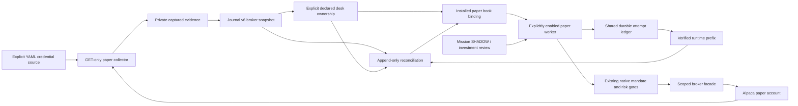

# Burst 5 — paper reconciliation and durable desk ownership

The confirmed Galactica paper credentials are in
`/Users/nikolai/buried_treasure/api_keys.yaml`, under `alpaca.key_id` and
`alpaca.secret_key`. The two previously tested environment files contain
different credential pairs. No credential file was changed or copied.

This burst adds explicit broker observation, declared desk ownership,
append-only reconciliation and durable restart protection. Auto-trading remains
OFF. Funded activation is unavailable in this paper-only implementation.
Canonical missions, Navigator SHADOW handoffs and investment research approvals
keep their existing meaning and do not grant execution authority.

## Contracts and authority



The worker/order branch is implemented and tested with mocks; it remains OFF
for the real account. The actual exercised path is collection, retention and
non-execution reconciliation.

Strict `BrokerSnapshotInput`, `DeskOwnershipInput` and `ReconciliationInput`
documents produce additive Decision Journal v6 events:

| Event | Meaning |
| --- | --- |
| `PAPER_BROKER_SNAPSHOT_RECORDED` | Retained account, position and order observations with capture windows |
| `TRADING_DESK_OWNERSHIP_RECORDED` | Explicit declared symbol ownership, linked to a verified snapshot |
| `TRADING_EXECUTION_RECONCILED` | Exact attempt/order identity, cumulative fills, unresolved acceptance and linked observations |

Their IDs are independent of mission SHADOW decision IDs. All capital,
execution, policy-change and investment authorization flags stay false.
`realized_trade_pnl` remains null. Acceptance, partial fill, complete fill,
cancellation, expiry and rejection are separate facts. Observing a fill is not
an authorization or a realized-profit calculation.

Observations support signed decimal quantities and nullable missing prices.
Missing timestamps, IDs and observations are not filled with fictional data.
Account/mode mismatches, changed input under an existing identity, rehashed
semantic tampering and incomplete source bindings reject. Original source bytes
are retained, while later observations append new events. Cumulative fills are
never summed repeatedly across snapshots. Histories cannot retreat their
capture cutoff or cumulative fills by omitting an intermediate observation.

Undeclared symbols are UNCLASSIFIED. TRADING and INVESTMENT symbol sets must be
disjoint because the native broker closes whole symbol positions. Declared
ownership is not retroactively assigned to older orders. Release or reassignment
requires a complete broker-confirmed flat symbol with no open order. Declared
identities and imported provider provenance remain unauthenticated; local
source hashes are not signed broker attestations.

## Persistence and runtime boundary

The existing immutable journal storage and verification are extended; no
database, migration, dependency or parallel agent framework is introduced.
Recording ownership requires exact account and desk-scope hash confirmations.
Installation separately binds verified journal events to the paper guard. The
binding limits an independently confirmed profile and grants no capital or
execution authority itself.

Each paper account has a persistent runtime ledger under this checkout's
`output/auto-trading-account-state/<account-hash>`. It reuses the existing
`RuntimeLedger` format, private writes and recovery. Changing the per-session
runtime folder does not erase unresolved attempts. The installed profile must
match both declared desk symbol sets exactly; trading holdings cannot be hidden
as protected investment holdings or omitted from their trading budget.

Normal paper startup requires an installed verified book. Scope installation
cannot occur while the account worker lock is held. A reconciliation refresh
for the same scope can be installed while protective exits run. A newer
uninstalled declaration blocks entries but preserves protective reductions for
the installed TRADING book until its explicit handoff. A passive declaration
cannot remove an active worker's exits before the scope change is installed.
Integrity failure or uncertain acceptance still requires manual reconciliation.

Runtime receipt v2 adds account ID, a stable per-occurrence attempt ID, prior
position quantity and returned client order ID. A complete ATTEMPT is durable
before a broker mutation. Shared account receipts are written before local
session receipts. Lost responses and ambiguous acceptance remain recorded; they
never trigger automatic resubmission. Known accepted IDs and their baselines
are restored into the broker facade before native construction. Native order
and position confirmation is still required before those latches clear.

New entries remain blocked until the exact shared-ledger prefix is reconciled
and installed. A successful reconciliation of an older prefix cannot clear a
later attempt. Empty open-order lists never prove that an uncertain submission
was rejected. An ambiguous response carrying an exact broker ID can be resolved
only with that order's terminal facts and reflected position quantity.
Uncertainty on one symbol does not remove another owned symbol's protective exits.

The account ledger is shared across runtime folders in this checkout, not
across unrelated checkouts, operating-system users or hosts. External executors
do not honor its locks. Trusted-root protection, rollback monitoring and
deployment-wide storage remain separate work.

## Explicit paper collection

The collector uses the fixed HTTPS paper host, GET only, with no redirects or
inherited proxies. It freezes one selected credential pair for the entire
capture so account facts cannot be combined with another account's exact orders
after an environment-file update. Credentials remain in memory.

The four base reads collect account, positions, bounded open orders and clock.
Explicit tracked IDs add GET `/v2/orders/<UUID>` reads for terminal and partially
filled orders. Exact ID, schema, quantity, status and capture-window validation
precedes confirmation. Failed or incomplete reads retain sanitized partial
evidence and cannot be imported as a complete snapshot. No submit, cancel,
close, account reset or capital operation exists in this collector.

```sh
export PYTHONDONTWRITEBYTECODE=1
export PYTHONPATH=src

.venv/bin/python3.11 -m blackpod_build_week.trading_reconciliation_cli capture-paper \
  --credential-source /Users/nikolai/buried_treasure/api_keys.yaml \
  --credential-format GALACTICA_YAML \
  --expected-account-id EXACT_PREVIOUSLY_CONFIRMED_ACCOUNT_ID \
  --output-root output/auto-trading-paper-check
```

Add `--tracked-order-id EXACT_BROKER_ORDER_UUID` for every relevant known order.
Only the explicitly requested tracked set is covered; a complete empty set is
not a statement that the account has no historical trades. An absent or unknown
order stays unresolved. Account snapshots consist of sequential reads and are
not an atomic portfolio view.

Import the returned evidence path:

```sh
.venv/bin/python3.11 -m blackpod_build_week.trading_reconciliation_cli import-probe \
  --journal-root output/auto-trading-reconciliation-real \
  --probe /absolute/path/to/returned-paper-capture.json
```

The same command supports the original confirmed four-read probe. Its
`tracked_orders_complete=false` makes the unobserved historical scope explicit.
Runtime prefixes can be exported read-only using `export-runtime --runtime-root
... --output ...`; source/mission/journal locations cannot be export targets.
Use the fixed account ledger's prefix when resolving its persistent barriers.

## Runnable synthetic example

These examples are explicitly synthetic. They do not classify the real paper
account or install a real book. From this checkout:

```sh
.venv/bin/python3.11 -m blackpod_build_week.trading_reconciliation_cli import-snapshot \
  --journal-root output/auto-trading-reconciliation-example \
  --snapshot examples/paper_broker_snapshot.fixture.v1.json \
  --evidence fixtures/trading_reconciliation/paper-broker-source.fixture.json

.venv/bin/python3.11 -m blackpod_build_week.trading_reconciliation_cli record-ownership \
  --journal-root output/auto-trading-reconciliation-example \
  --ownership examples/trading_ownership.paper.v1.json \
  --confirm-account-id paper-account-example \
  --confirm-desk-scope-sha256 273c32dbbf96397dc3753b6f84c4f89d367fd0764f19808f33abc17d58f5983c

.venv/bin/python3.11 -m blackpod_build_week.trading_reconciliation_cli record-reconciliation \
  --journal-root output/auto-trading-reconciliation-example \
  --reconciliation examples/trading_reconciliation.paper.v1.json

.venv/bin/python3.11 -m blackpod_build_week.harbormaster journal verify \
  --journal-root output/auto-trading-reconciliation-example
```

Result: **3 events, 4 evidence blobs, zero orphans**, with status
`NO_EXECUTION_OBSERVED`. Repeating recording commands is a no-op. The committed
expected reconciliation event reproduces byte-for-byte.

`reconcile` can build an observation from explicitly selected snapshot,
ownership and runtime evidence. `show` reads it. `install-paper-book` binds
recorded ownership and, optionally, an exact reconciliation to the account guard;
it requires account confirmation. No command here enables trading. Use help for
required identifiers; do not substitute sample ownership for a real book.

## Verification and limits

See [validation results](TRADING_RECONCILIATION_VALIDATION.md) for exact commands,
test counts, real history and files changed.

This burst does not compute attributable realized P&L. Lot matching, cost basis,
fees and corporate actions need a separately tested accounting method.
Replacement-chain IDs and cumulative fills are retained, but attribution
uncertainty keeps replacement barriers blocked. Legacy receipts without a
recorded prior position remain conservative. No symbol/time guessing is used.

Original broker timestamp bytes retain nanoseconds; normalized datetime fields
currently use microseconds. Paper fills do not validate funded execution
performance. Native buffered market orders still cannot guarantee fill-price
caps. Source identities, timestamps, declarations and local storage require a
trusted environment. Full replay cost, retention, external signed checkpoints
and cross-host coordination remain open. Investment allocations and the
inactive initial 50/50 capital proposal remain separate and unchanged.
Native audit CSVs and full source/input snapshots remain in runtime session
storage. Profile hashes are exported, but a journal restore alone does not
reconstruct every native decision or streamed bar; preserve those session archives.
