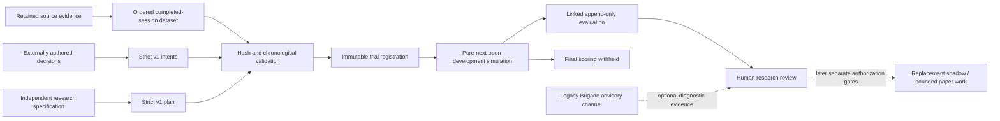

# Trading research contract and offline evaluation foundation

This is a new, strategy-neutral boundary for the **TRADING** desk. It accepts
explicitly authored research hypotheses and candidate decisions, evaluates
them against retained observations, and records reproducible simulation
results. It does not import Galactica strategy rules, forecasts, Brigade voting
criteria, Navigator mandates, entry/exit heuristics, stops or sizing policies.
Existing historical interfaces and their original replay behavior remain
available separately; none is a replacement strategy by default.

**Auto-trading remains OFF.** Evaluation cannot install symbol ownership,
activate a budget, change live policies, submit orders, start inference or
transfer capital. Simulated fills and simulated net P&L are research outputs,
not broker executions or realized account returns. The recorded two-desk
capital proposals remain inactive.

## Why Brigade consistency is a separate branch

Deterministic Brigade evidence-consistency review remains useful for checking
whether an advisory response contradicts its supplied evidence. It should
retain the original recommendation and dissent, and append explicit diagnostic
findings. It would improve the reliability of the existing research channel;
it would not create an independently tested trading edge.

The new trading research contract does not depend on Brigade votes or legacy
signal definitions. Build and evaluate replacement strategies through this
new boundary first. A later Brigade consistency diagnostic can operate in
parallel, or contribute separately labeled challenge evidence when a research
hypothesis explicitly requests it. Neither valid formatting nor a clean
consistency check constitutes strategy promotion or execution authorization.
This burst does not implement that diagnostic.

## Evidence and experimental discipline

A research specification must explain the proposed mechanism, target universe
and horizon, decision timing, evidence availability, falsification conditions,
cost assumptions, benchmark and bounded simulated exposure. The specification
and all candidate decisions remain retained exactly as submitted. The evaluator
does not infer missing expectations, confidence, stops or investment theses.

The dataset binds observation time separately from the time the observation
became available. Candidate evidence must exist before its decision time, and
fills must occur strictly after the decision with the evaluator's declared
fill convention. Chronological training, validation and final holdout periods
remain distinct. Availability checks and a declared purge/gap boundary are
necessary even where timestamps are sorted; sorting alone is not proof that
information was known at the decision.

Research records include every declared trial, including rejected and
unpromising alternatives. Trial metadata and registration chronology are
retained declarations and local bindings, not external proof that every
experiment was disclosed or that a human did not inspect the holdout earlier.
No run changes a strategy or capital policy based on its results.

The first evaluator is deliberately limited. It provides deterministic
simulation/accounting and explicit, consistently defined descriptive measures;
it does not claim calibrated probabilities, proven alpha, realistic market
capacity or live execution quality. A valid contract and a passing simulator
test establish reproducibility, not profitability.

Candidate sizes are supplied research inputs. The evaluator enforces declared
simulation limits and rejects inadmissible decisions; it does not recommend an
optimal symbol or size, learn a strategy, invent a stop, or reuse a historical
desk-review allocation. Initial simulated cash is a standalone experiment
parameter, not an activation or reservation of the recorded paper budget.

Cash is an explicitly declared first benchmark. It gives a transparent zero
return comparison under the stated convention, rather than silently importing
a legacy strategy as a baseline. Future risk/exposure-matched strategy and
market benchmarks need their own predeclared definitions. A favorable comparison
to cash alone does not show skill, account for all opportunity costs, or justify
automated deployment.

## Implemented contracts and simulation method

`contracts/trading_research.py` exposes immutable `TradingResearchPlan`,
`TradingResearchDataset` and `TradingResearchIntents`, each with a strict v1
schema. Unknown fields, coercion of quantities/booleans, nonfinite numbers,
malformed timestamps and enabled authority are rejected. Monetary values and
costs use fixed-point decimal strings; BUY and SELL require positive whole-share
quantities, and HOLD has exactly zero quantity.

| Contract | Required declarations |
| --- | --- |
| `blackpod.trading_research_plan.v1` | Unique plan/experiment/trial IDs; registration clock; independent hypothesis, expected edge and falsification conditions; sorted universe; DAY/SWING horizon; exact dataset/intent references; chronological fold indices and embargo; final holdout; costs; simulated risk bounds; CASH benchmark; prior trial IDs; disabled authority. |
| `blackpod.trading_research_dataset.v1` | Unique dataset ID; recording clock; sorted universe; original source references; declared availability policy; ordered completed sessions with separate open/close/availability clocks and rectangular OHLCV; historical point-in-time verification explicitly false. |
| `blackpod.trading_research_intents.v1` | Unique intent set bound to the plan; creation clock; externally authored origin; unique decision IDs with fold, source session, decision time, action, symbol and quantity; disabled authority. |

The only supported strategy implementation status is `EXTERNAL_INTENTS_ONLY`.
The v1 evaluator accepts no executable strategy plugin and fits no model.
The ancestry label `INDEPENDENT_NEW_RESEARCH_SPECIFICATION` is a retained
author declaration; it does not independently prove how a person generated
the decisions. Avoid copying legacy rules into those external inputs.

`trading_research_evaluation.py::evaluate_research` implements
`blackpod.next_open_research_evaluation.v1`. Each development TEST fold begins
flat with independently reset simulated cash. TRAIN and VALIDATION data supply
declared partition/availability metadata; they do not produce trades or a fitted
strategy. A source session's declared label at `source_index + label_horizon`
is purged when it crosses the training boundary or became available after the
declared training cutoff. Features must also be available by that cutoff;
availability times are not assumed to increase with session order. This
projects leakage checks; it does not verify
any actual model training or label use.

A split with training features/labels available only after validation begins,
or no eligible declared training-label samples, receives
`DEFER_SPLIT_AVAILABILITY_INVALID` without simulation metrics. Ordinary
boundary-crossing label purging remains visible and does not itself invent
a model failure or authorize a different split.

The simulator schedules an admissible decision only at its source session's
immediately following opening. The source must have been available at the
decision, the decision must strictly precede that opening, and the source
must satisfy the declared staleness bound at both the decision and simulated
next opening. Only TEST openings
can fill. Decisions targeting other partitions or the final holdout are
explicitly rejected rather than moved to a more convenient session. DAY plans
are registrable but receive `DEFER_UNSUPPORTED_DAY_HORIZON` with no simulation:
daily OHLCV cannot establish intraday entry/exit paths.

For a reference opening price `p`, the adverse price fraction is
`(spread_bps / 2 + slippage_bps) / 10000`. BUY fills use `p * (1 + fraction)`;
SELL fills use `p * (1 - fraction)`. Fees are
`fee_per_fill + fill_notional * fee_bps / 10000`. These are explicit fixed
assumptions, not observed bid/ask spreads or broker charges. Known volume comes
from the prior completed source bar, never the execution session's later final
volume. The participation allowance is pooled over all executed quantities for
the same symbol at one opening, including both buys and sells; splitting a
decision into smaller inputs cannot multiply the allowance. It is a screening
bound, not evidence of available opening liquidity.

Cash, per-order notional, position fraction, gross exposure and known-volume
participation limits reject inadmissible fills. Admission uses the assumed
opening fill price in this offline model; it does not establish how an eventual
live order would remain bounded through gaps or changing liquidity. Simultaneous
opening decisions use deterministic decision-ID order. BUY lots and SELL matches
use new strategy-neutral FIFO accounting, with exact remaining fee attribution
on partial closes. The holding-period limit flags a breach; it never invents
a liquidation rule, stop or exit.
Position and gross fractions are admission limits. Subsequent price movements
can breach them without a new entry; OPEN/CLOSE exposure and holding breaches
are recorded as diagnostics, with no forced trade. The observed breach count
is not a production risk certification. A 20,000-row combined training/equity
projection cap rejects before simulation, while journal byte limits still
apply independently at publication.

Per-fold metrics include simulated net return, net expectancy per sell fill,
turnover, modeled price/fee costs, close drawdown and duration, realized/unrealized
simulation reconciliation and terminal exposure. Sell-fill win rate and profit
factor use sell fills as their sample unit, not inferred independent round-trip
trades. Profit factor is null when loss denominator is zero. Sharpe, Sortino,
annualized return and significance remain unassessed/null. Opening and closing
marks do not reconstruct intraday drawdown. Fold returns are not compounded
into a fictional account: the aggregate is null because cash resets per fold.

Final-holdout scoring is withheld. The dataset remains retained and readable,
so this is not an access-sealed holdout or proof that its prices were never
seen by the author. Proper independently controlled holdout access and
selection-bias/uncertainty measures require later research governance.



There is no edge from evaluation to the execution controller in this burst.

## Journal integration and recovery

`trading_research_journal.py::build_plan_event` adds passive journal v12
`TRADING_RESEARCH_PLAN_REGISTERED`. Registration binds the full specification,
dataset, original source bytes and externally authored intent bytes. Within
one experiment, the universe, horizon, dataset, protocol, costs, risk bounds
and benchmark stay fixed; changing them requires a new experiment identity.
Each new trial must list all earlier trials from that experiment in the same
verified journal, including alternatives whose evaluations failed or were
unpromising. The local registry cannot discover experiments conducted elsewhere.

`build_evaluation_event` adds `TRADING_RESEARCH_EVALUATION_RECORDED`, linked to
the original plan event and the same decision identity. An evaluation requires
prior registration. Later evaluation IDs append; they do not rewrite the plan,
decisions, evidence or previous result. Reusing a plan/trial/evaluation identity
with different content is a conflict, while an identical retry is idempotent.
The event keeps `realized_trade_pnl` null; simulation-specific monetary fields
remain explicitly named and scoped as simulation.

Journal verification recomputes the versioned evaluation from retained inputs.
It makes no broker/provider request, fits no model and runs no external strategy.
Source wrappers retain their recursively hash-bound raw evidence closure, not
only the immediate JSON document. Declared dataset values and availability are
not independently reconstructed/authenticated from arbitrary vendor wrappers.
Replay requires the v1 evaluator semantics to remain available; this burst
does not snapshot or authenticate a complete executable environment. Future
method changes must preserve the old version or use a new versioned path.
The existing immutable storage handles hash verification, no-follow paths,
content-addressed evidence, locking, safe writes and interrupted append recovery.
An interrupted append can be retried with the original identity and bytes;
the journal either reuses the committed event or appends the missing event.
Privileged complete-chain rewriting still requires an external trusted checkpoint
to detect; local hashes are not external attestation.

The CLI is `python -m blackpod_build_week.trading_research_cli`:

| Command | Effect |
| --- | --- |
| `register --plan --evidence-root --journal-root` | Freeze a strict research trial and its evidence in the passive journal. |
| `evaluate --plan --evidence-root --journal-root` | Recompute a previously registered trial and print its simulated result without appending. |
| `record --plan --evidence-root --journal-root --evaluation-id --recorded-at` | Append a linked reproducible simulation evaluation. The explicit recording clock cannot precede retained inputs or registration. |
| `verify --journal-root` | Verify/recompute the complete journal with retained evidence only. |
| `show --journal-root --event-id` | Read one verified registration or evaluation. |
| `render --journal-root --event-id --output` | Publish a self-contained passive HTML report of an evaluation, with no execution control. |

After registration, retained blobs can supply inputs if the original evidence
files are unavailable. The plan argument must still match the original retained
plan exactly; changing a redundant file does not amend that plan. Keep journal,
external input, evidence and runtime storage paths separate. No command writes
into a source repository, canonical mission store or installed execution ledger.

## Runnable synthetic example

Run these commands from the Build Week checkout. The existing virtual
environment is sufficient; no new dependency or credential is required.
The chosen output root is distinct from older preliminary example captures,
which remain immutable.

```sh
PYTHONDONTWRITEBYTECODE=1 PYTHONPATH=src .venv/bin/python3.11 \
  -m blackpod_build_week.trading_research_example \
  --output-root output/trading-research-foundation-example

PYTHONDONTWRITEBYTECODE=1 PYTHONPATH=src .venv/bin/python3.11 \
  -m blackpod_build_week.trading_research_cli register \
  --plan output/trading-research-foundation-example/input/plan.json \
  --evidence-root output/trading-research-foundation-example/evidence \
  --journal-root output/trading-research-foundation-example/journal

PYTHONDONTWRITEBYTECODE=1 PYTHONPATH=src .venv/bin/python3.11 \
  -m blackpod_build_week.trading_research_cli evaluate \
  --plan output/trading-research-foundation-example/input/plan.json \
  --evidence-root output/trading-research-foundation-example/evidence \
  --journal-root output/trading-research-foundation-example/journal

PYTHONDONTWRITEBYTECODE=1 PYTHONPATH=src .venv/bin/python3.11 \
  -m blackpod_build_week.trading_research_cli record \
  --plan output/trading-research-foundation-example/input/plan.json \
  --evidence-root output/trading-research-foundation-example/evidence \
  --journal-root output/trading-research-foundation-example/journal \
  --evaluation-id synthetic-independent-trading-evaluation \
  --recorded-at 2026-01-22T23:00:00Z

PYTHONDONTWRITEBYTECODE=1 PYTHONPATH=src .venv/bin/python3.11 \
  -m blackpod_build_week.trading_research_cli show \
  --journal-root output/trading-research-foundation-example/journal \
  --event-id journal-event-5aabb09a930e5b2c47ab839a986066cd73af1b0b1821ccc637487c30405709d2

PYTHONDONTWRITEBYTECODE=1 PYTHONPATH=src .venv/bin/python3.11 \
  -m blackpod_build_week.trading_research_cli render \
  --journal-root output/trading-research-foundation-example/journal \
  --event-id journal-event-5aabb09a930e5b2c47ab839a986066cd73af1b0b1821ccc637487c30405709d2 \
  --output output/trading-research-foundation-example-report/review.v2.html

PYTHONDONTWRITEBYTECODE=1 PYTHONPATH=src .venv/bin/python3.11 \
  -m blackpod_build_week.trading_research_cli verify \
  --journal-root output/trading-research-foundation-example/journal
```

Preparation creates `input/plan.json`, three retained evidence files, an
`example.json` manifest, expected replay/IDs and a journal with only the plan
registration. It computes the expected pure replay for the authored fixture
but records no evaluation until the explicit `record` command. The subsequent
`register` command is therefore an idempotent retry, with `written: false`.
Repeating `record` likewise reuses the original evaluation without rewriting it.

The example has 12 authored sessions, fictional `SYNTHA`/`SYNTHB` observations
and five fixed decisions. Its independent simulated cash is $1,000. TRAIN is
indices 0–3, VALIDATION 5–6, development TEST 8–10, and final holdout 11; each
intermediate gap is one session. The declared seven-day staleness allowance
accommodates this synthetic session spacing; it is not a live trading policy.

The authored buy of two shares and two single-share exits produce three
simulated fills and two FIFO matches. HOLD produces no fill, and the oversized
second-symbol entry is explicitly rejected. Under the declared fixed costs,
fill prices are $100.10, $101.898 and $102.897, fees total $0.30, adverse price
cost is $0.405, and ending simulated equity is $1,004.295. The $4.295 net
simulation result is deliberately constructed for accounting checks; it is
not a historical market backtest, realized paper-account P&L or evidence of edge.
After recording, the example journal has two linked events and four retained
evidence blobs, with no evidence or staging orphans.

Use [the validation report](TRADING_RESEARCH_VALIDATION.md) for the exact
commands executed, current test totals and coverage limitations.

## Shared infrastructure and isolated authority

The foundation reuses the immutable journal and safe passive artifact writers.
Research evidence is retained separately from mission histories, active runtime
storage and native source trees. Forecasts, recommendations, authorization,
executable orders and simulated fill records remain different concepts.

The investment desk keeps its own hypotheses, evaluation horizons, policy
and authorization. This TRADING research boundary grants no investment or
capital-allocation authority. Strategy replacement later requires an explicit
execution seam, independently validated deterministic risk controls, desk
ownership, budget activation, bounded sizes and loss limits, human approval,
and verified rollback/reconciliation. Those are subsequent gates, not effects
of this offline evaluator.

## Follow-on work

The next research burst should specify a small number of entirely new trading
hypotheses and simple comparison baselines, then assemble retained, versioned
historical evidence suitable for chronological evaluation. Register trials
before evaluation, report failures and costs, and keep the final holdout
isolated. Advanced forecasting earns a role only through incremental evidence
under the same evaluation assumptions.

Further simulator versions may add explicit intrabar fill rules, partial
fills, spread/volume/capacity models, financing, corporate actions, shorting,
and uncertainty or selection-bias diagnostics. Each needs an independently
specified convention and tests; missing capabilities must not be silently
approximated. No automatic promotion, paper activation or legacy strategy
reuse is planned as part of this foundation.
