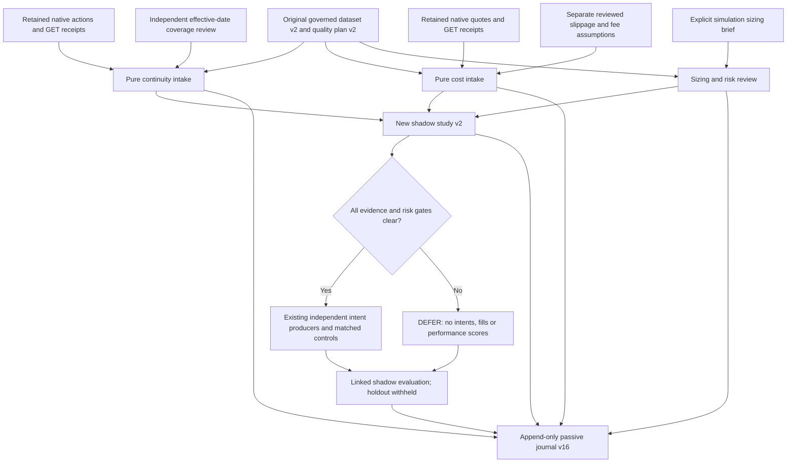

# Governed market evidence and shadow sizing

This burst adds pure adapters for retained native Alpaca corporate actions and
historical quotes, a separate simulation sizing/risk review, and journal v16.
**Auto-trading remains OFF.** These commands do not contact a provider, read
credentials, start inference, submit orders, activate either desk's capital,
transfer funds or choose a winning strategy. Galactica trading rules are absent.

The original hypothesis, data-quality plan, dataset and prior evaluations stay
immutable. A new `blackpod.trading_shadow_study.v2` binds those originals to
exact continuity/cost intake exports and one explicit risk-review document.
An `APPROVED_FOR_SHADOW` review governs simulation declarations only; it is
neither authenticated human approval nor paper-trading authorization.



## Continuity evidence

`ContinuityIntakeRequest` names the exact governed dataset/universe, retained
response/receipt pages, process-date interval, scope and optional independent
`ContinuityCoverageReview`. Each receipt binds GET, the allowed data endpoint,
query, actual HTTP status, capture clock, response SHA-256 and byte count. Page
tokens must form a complete forward chain; unavailable or incomplete captures
retain an explicit disposition.

Native action IDs, types, process dates, affected symbols and effective-date
basis are preserved. Actions effective before or after the dataset remain in
the audit even when they create no dataset event. Effective dates between
returned sessions map to the next actual included session. Unknown effective
dates remain unresolved. Any in-dataset price discontinuity defers the entire
raw-price study; this burst performs no price adjustment or total-return repair.

A completed process-date response does not establish complete effective-date
coverage. The independent review must bind the full dataset and universe and
retain support distinct from the provider response itself. The provider also
describes delayed availability and exclusion of some unprocessed incomplete
records under its default data-quality setting. See the [Alpaca corporate-action
reference](https://docs.alpaca.markets/us/reference/corporateactions-1).

The adapter supports thirteen native action groups. New or unknown groups,
including currently unsupported partial calls, reorganizations and capital-gains
distributions, fail closed. A local reviewer claim is retained evidence, not
provider authentication or proof of economic completeness.

## Cost evidence

`CostIntakeRequest` binds the exact dataset, ordered native quote pages, scope,
reviewer notes and optional `CostAssumptionReview`. The retained query explicitly
uses the full sorted universe, IEX, USD, ascending order, a declared time window,
page limit and `asof=-`. Every continuation must preserve that query and use the
preceding native token. The quote endpoint's limit applies across all symbols;
a short page alone proves nothing about pagination. See the [Alpaca historical
quote reference](https://docs.alpaca.markets/us/reference/stockquotes-1).

The adapter validates all nine native quote fields: `t`, `bp`, `bs`, `bx`, `ap`,
`as`, `ax`, `c`, and `z`. Numeric tokens become Decimal values directly from
retained JSON. Nanosecond timestamps retain their original spelling and are
compared without microsecond truncation. Distinct updates sharing a timestamp
are retained, including across page boundaries; identical duplicate observations
and descending timestamps reject instead of being silently deduplicated.

The fixed admission policy requires positive bid/ask prices and sizes,
noncrossed quotes, exactly the regular `R` condition, and a timestamp from the
session opening through opening plus sixty seconds. For every symbol, every
included dataset session needs at least one eligible quote. A selective recent
sample cannot support the other historical sessions.

Each symbol's maximum observed `(ask-bid)/midpoint * 10000` is rounded **up** to
eighteen decimal places. The combined model takes the maximum symbol bound.
Spread extremes are retained, never clipped to pass a gate. The existing
calculation gates additionally require all 1×/2×/4× stresses to remain within
their supported ranges and reject zero modeled price friction.

Quotes cannot empirically estimate slippage or fees for unexecuted orders.
Those parameters require an immutable, separately supported review with full
dataset/universe/session coverage, explicit values and
`REVIEWED_SHADOW_ASSUMPTIONS` status. Missing or unresolved assumptions leave
`cost_model=null`; missing symbols do not acquire invented zero bounds. No
assumption is accepted because it improves historical P&L.

IEX opening-minute samples do not establish consolidated liquidity, opening
auction execution, capacity, fills or historical point-in-time availability.
Both measured sample bounds and local assumptions remain visible in provenance.
Spread bounds use the entire requested dataset coverage, including sessions
outside development TEST folds. They are retrospective sample bounds, not
claims that those costs were known at each historical decision. Withheld
performance scoring does not establish prospective cost preregistration.

## Explicit sizing and risk review

`TradingShadowRiskReview` binds the exact original quality plan, supporting
brief, reviewer identity, scope, status, per-symbol sizing and six simulation
limits: initial cash, maximum order notional, position fraction, gross fraction,
known-volume participation and staleness. Status is `PROPOSED`,
`APPROVED_FOR_SHADOW`, `REJECTED` or `DEFERRED`.

The pure assessment reports cash/position/order/gross feasibility and each TEST
opportunity using the completed source session's close and volume. It retains
whole-share rounding, below-one-share deferrals and volume-cap failures. Future
opening prices and returns do not select the size. An approval with infeasible
caps still defers; quote size is not substituted for demonstrated capacity.

Only an eligible review prepares an internal simulation-risk projection. The
original plan bytes remain the source of record. The projection is retained
inside the linked study evidence and cannot replace the registered plan or
activate the recorded paper desk budgets. Execution still has no authority.

## Journal and version boundaries

Journal v16 introduces five event kinds:

| Event | Recorded meaning |
| --- | --- |
| `TRADING_CONTINUITY_INTAKE_RECORDED` | Native actions and explicit coverage disposition |
| `TRADING_COST_INTAKE_RECORDED` | Quote sample, distinct assumptions and cost disposition |
| `TRADING_SHADOW_RISK_REVIEW_RECORDED` | Declared sizing/risk and deterministic feasibility |
| `TRADING_REVIEWED_SHADOW_STUDY_REGISTERED` | Frozen original plan, unique preceding evidence/review links and trial |
| `TRADING_REVIEWED_SHADOW_EVALUATION_RECORDED` | Linked intent production and shadow calculation or explicit DEFER |

Retained bodies, receipts, declarations, support and source code are hash-bound.
Verification and append replay the adapters, risk assessment, source links and
calculation. Existing immutable storage provides exact retry idempotency,
conflict detection, safe writes, interrupted-publication recovery and separate
source/journal roots. An evaluation appends; it never rewrites the study.

The v15 calculation files remain unchanged. New study/evaluation records also
pin the additive calculation sources. Editing installed pinned code causes
verification to reject; future semantic changes need explicit versions and a
governed replay/migration design. This burst does not provide such a migration.
Failed/deferred trials remain retained, and global trial completeness and
historical preregistration remain unverified.

## Observed real-data coverage

The retained QQQ/SPY dataset has 760 sessions per symbol. This burst retained
one corporate-action response and three forward historical-quote pages in
`output/trading-research-evidence-source-001`:

- 26 native corporate actions: 24 mapped into the dataset; two retained before it.
- 21,470 native quotes: QQQ 8,763 and SPY 12,707, including 489 adjacent
  timestamp ties between distinct updates.
- The opening-minute quote sample covers one session; 1,518 symbol/session pairs
  remain missing across the complete dataset.

No independent real effective-date coverage review or real slippage/fee
assumption review was supplied. The real risk declaration remains `PROPOSED`:
USD 10,000 simulation cash, USD 1,000 per symbol and per order, position 0.1,
gross 0.2, volume 0.01 and staleness 604,800 seconds. These are explicit research
inputs, not optimized allocations, authenticated approval or active desk capital.
Real studies therefore defer without intents, fills or performance scores.
The detailed verification report is [TRADING_SHADOW_EVIDENCE_VALIDATION.md](TRADING_SHADOW_EVIDENCE_VALIDATION.md).

## Runnable offline example and all twelve CLI commands

Run these from the repository checkout. The authored example has 40 fictional
sessions, 80 native-shaped quotes, independent authored continuity coverage and
cost assumptions, and two approved toy simulation reviews. It creates fourteen
events with zero orphan evidence. Its USD 1,000 cash and USD 60 per-symbol sizes
are unrelated to the recorded paper budgets. Its synthetic returns establish
software behavior, not trading performance.

```sh
cd /Users/nikolai/Projects/blackpod_battlestar_build_week
export PYTHONDONTWRITEBYTECODE=1
export PYTHONPATH=src
BP_PYTHON=.venv/bin/python3.11
BP_EXAMPLE="$PWD/output/trading-research-governed-evidence-example-002"

"$BP_PYTHON" -m blackpod_build_week.trading_shadow_review_example \
  --output-root "$BP_EXAMPLE"

bp_review() {
  "$BP_PYTHON" -m blackpod_build_week.trading_shadow_review_cli "$@"
}

bp_id() {
  "$BP_PYTHON" - "$BP_EXAMPLE/journal" "$1" <<'PY'
import sys
from blackpod_build_week.decision_journal_store import JournalStore
events, _ = JournalStore(sys.argv[1]).verified_contents()
selector = sys.argv[2]
if selector == "base":
    event = next(e for e in events if e.event_type == "TRADING_RESEARCH_PLAN_REGISTERED"
                 and e.source["plan_id"] == "synthetic-shadow-base-plan-h1")
elif selector == "risk":
    event = next(e for e in events if e.event_type == "TRADING_SHADOW_RISK_REVIEW_RECORDED"
                 and e.source["risk_review_id"] == "synthetic-reviewed-risk-h1")
elif selector == "continuity":
    event = next(e for e in events if e.event_type == "TRADING_CONTINUITY_INTAKE_RECORDED")
elif selector == "cost":
    event = next(e for e in events if e.event_type == "TRADING_COST_INTAKE_RECORDED")
elif selector == "evaluation":
    event = next(e for e in events if e.event_type == "TRADING_REVIEWED_SHADOW_EVALUATION_RECORDED"
                 and e.source["evaluation_id"] == "doc-governed-evaluation-h1")
else:
    raise ValueError("unknown documented selector")
print(event.event_id)
PY
}

BP_BASE_EVENT_ID="$(bp_id base)"
BP_RISK_EVENT_ID="$(bp_id risk)"
BP_CONTINUITY_EVENT_ID="$(bp_id continuity)"
BP_COST_EVENT_ID="$(bp_id cost)"
```

The first two commands reconstruct the fixture exports as immutable artifact
files. The next three retry already recorded intake/risk declarations without
adding journal events. The later commands create a separate documented shadow
study and append its evaluation.

```sh
# 1. Project retained actions; does not record a journal event.
bp_review export-continuity \
  --request "$BP_EXAMPLE/input/continuity-intake.json" \
  --evidence-root "$BP_EXAMPLE/evidence" \
  --output-directory "$BP_EXAMPLE/exports/continuity"

# 2. Project retained quotes and separate assumptions.
bp_review export-cost \
  --request "$BP_EXAMPLE/input/cost-intake.json" \
  --evidence-root "$BP_EXAMPLE/evidence" \
  --output-directory "$BP_EXAMPLE/exports/cost"

# 3. Append/retry the continuity intake.
bp_review record-continuity \
  --export "$BP_EXAMPLE/exports/continuity/continuity-intake/export.v1.json" \
  --evidence-root "$BP_EXAMPLE/exports/continuity" \
  --journal-root "$BP_EXAMPLE/journal" --recorded-at 2025-04-01T12:00:00Z

# 4. Append/retry the cost intake.
bp_review record-cost \
  --export "$BP_EXAMPLE/exports/cost/cost-intake/export.v1.json" \
  --evidence-root "$BP_EXAMPLE/exports/cost" \
  --journal-root "$BP_EXAMPLE/journal" --recorded-at 2025-04-01T12:00:00Z

# 5. Record the explicit, fixture-only risk review.
bp_review record-risk \
  --review "$BP_EXAMPLE/input/risk-review-1.json" \
  --evidence-root "$BP_EXAMPLE/evidence" --journal-root "$BP_EXAMPLE/journal"

# 6. Publish a new study declaration without registering it.
bp_review prepare --journal-root "$BP_EXAMPLE/journal" \
  --base-plan-event-id "$BP_BASE_EVENT_ID" --risk-review-event-id "$BP_RISK_EVENT_ID" \
  --continuity-event-id "$BP_CONTINUITY_EVENT_ID" --cost-event-id "$BP_COST_EVENT_ID" \
  --study-id doc-governed-shadow-h1 --experiment-id doc-governed-shadow-experiment-h1 \
  --registered-at 2025-04-02T14:00:00Z --output-directory "$BP_EXAMPLE/prepared-h1"

BP_STUDY="$BP_EXAMPLE/prepared-h1/trading-shadow-review/study.v2.json"

# 7. Freeze the new study in its own append-only record.
bp_review register --study "$BP_STUDY" --evidence-root "$BP_EXAMPLE/prepared-h1" \
  --journal-root "$BP_EXAMPLE/journal"

# 8. Read-only assessment of that registration; no new evaluation event.
bp_review evaluate --study "$BP_STUDY" --journal-root "$BP_EXAMPLE/journal"

# 9. Append the linked evaluation; preserve the original study.
bp_review record --study "$BP_STUDY" --journal-root "$BP_EXAMPLE/journal" \
  --evaluation-id doc-governed-evaluation-h1 --recorded-at 2025-04-02T15:00:00Z

BP_EVALUATION_EVENT_ID="$(bp_id evaluation)"

# 10. Display the exact verified record.
bp_review show --journal-root "$BP_EXAMPLE/journal" --event-id "$BP_EVALUATION_EVENT_ID"

# 11. Render a local, escaped HTML report from verified journal evidence.
bp_review render --journal-root "$BP_EXAMPLE/journal" --event-id "$BP_EVALUATION_EVENT_ID" \
  --output "$BP_EXAMPLE/reports/reviewed-shadow-h1.html"

# 12. Verify the complete retained chain and replay.
bp_review verify --journal-root "$BP_EXAMPLE/journal"
```

The extended example ends with sixteen events, fifty-five retained evidence
blobs, zero orphan evidence, no orders and no provider calls. The final holdout
remains withheld. Repeating unchanged
commands preserves the same study/evaluation identities and retained bytes;
conflicting existing files are not overwritten. Use a new output root and new
study/experiment identities for intentionally changed declarations.

Only typed, schema-declared source relationships are followed. Provider bodies,
calendar arrays and origin briefs remain opaque retained leaves; arbitrary
embedded JSON references are not executed or recursively discovered. Commands
reject overlapping source/journal roots, symlinks, mismatched hashes/sizes and
unsupported declarations. Runtime OFF status remains an independent operational
check; none of these commands operates that switch.
